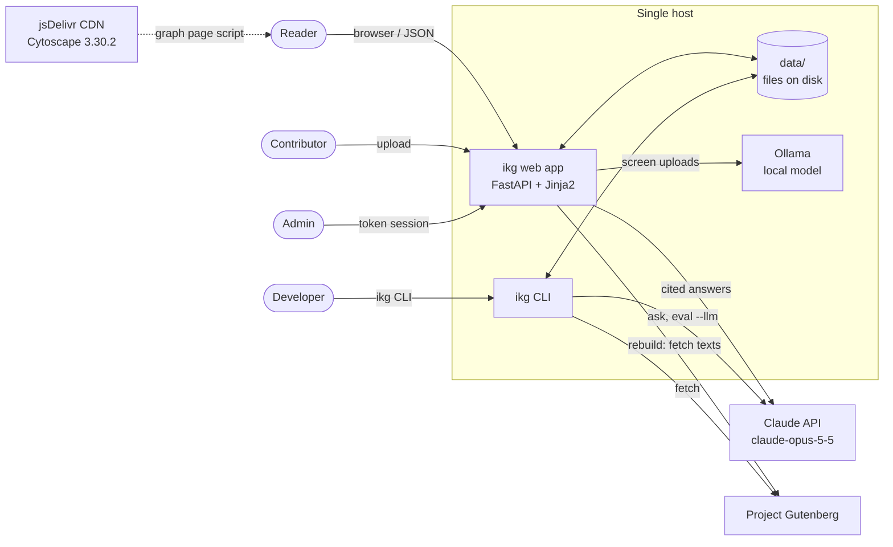
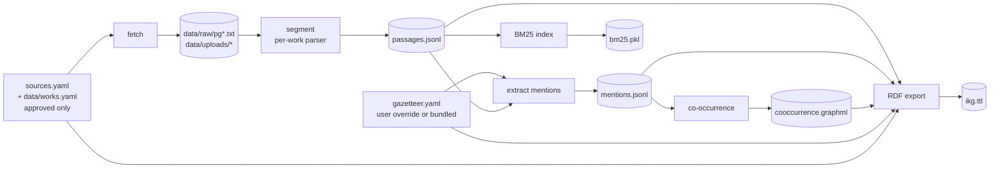
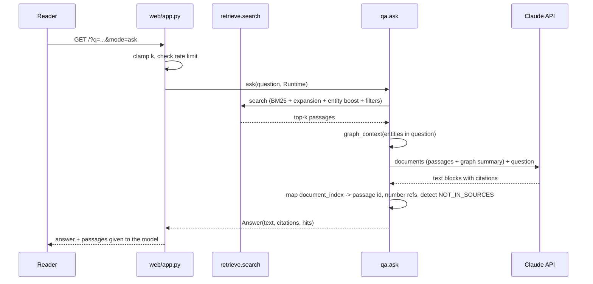
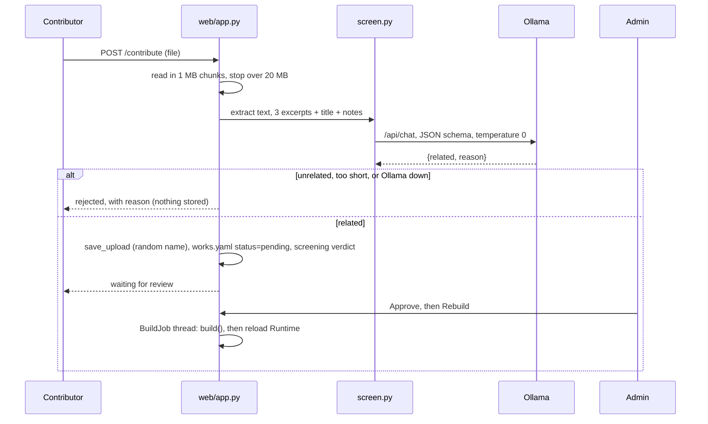

# 02 Architecture

## 1. System context



**External dependencies**

| Dependency | Used for | Needed for |
|---|---|---|
| Project Gutenberg | Downloading bundled and admin-added texts | `fetch` and `build` only. Once files are in `data/raw/`, no network is needed |
| Claude API (`ANTHROPIC_API_KEY`) | Cited answers | Ask mode, `ikg ask`, `ikg eval --llm` |
| Ollama (local) | Relevance screening of uploads | Contributor and admin uploads, unless `IKG_SCREEN=off` |
| jsDelivr | Cytoscape library for the graph page | `/graph` in the browser |

## 2. Components

```mermaid
flowchart TB
    subgraph interfaces[Interfaces]
        cli[cli.py]
        web[web/app.py<br/>routes, auth, rate limit, BuildJob]
        tpl[web/templates + static/graph.js]
    end
    subgraph core[Core library: src/ikg]
        sources[sources.py<br/>work registry, fetch, uploads]
        segment[segment.py<br/>parsers -> Passage]
        normalize[normalize.py<br/>fold, tokenize]
        entities[entities.py<br/>Gazetteer -> Mention]
        retrieve[retrieve.py<br/>BM25 + expansion + boost]
        graph[graph.py<br/>co-occurrence, RDF]
        qa[qa.py<br/>Claude with citations]
        screen[screen.py<br/>Ollama relevance check]
        pipeline[pipeline.py<br/>build, Runtime]
        analysis[analysis.py]
        evaluate[evaluate.py]
        config[config.py]
    end
    cli --> pipeline & retrieve & qa & analysis & evaluate
    web --> pipeline & retrieve & qa & screen & sources & entities
    web --> tpl
    pipeline --> sources & segment & entities & retrieve & graph
    segment --> normalize
    entities --> normalize
    retrieve --> entities
    qa --> retrieve & graph
    evaluate --> retrieve & qa
```

| Module | Responsibility | Depends on |
|---|---|---|
| `config.py` | Paths (overridable with `IKG_DATA`), model IDs, screening settings | none |
| `normalize.py` | Diacritic folding, tokenisation with archaic stopwords, Roman numerals | none |
| `sources.py` | Merges the bundled and user work registries, handles approval status, Gutenberg download and boilerplate stripping, upload storage | `config` |
| `segment.py` | One parser per edition, plus a generic parser; produces `Passage` records | `sources`, `normalize` |
| `entities.py` | Gazetteer loading and validation, regex matching, mention extraction | `segment`, `normalize` |
| `retrieve.py` | BM25 index, query expansion from the gazetteer, entity boost, filters | `entities`, `segment` |
| `graph.py` | Co-occurrence graph (networkx, GraphML) and RDF export (rdflib, Turtle) | `entities`, `segment`, `sources` |
| `qa.py` | Prompt, document blocks, Claude call, citation mapping, abstention | `retrieve`, `graph` |
| `screen.py` | Text extraction, excerpt sampling, Ollama call with a JSON schema, verdict | `sources`, `config` |
| `pipeline.py` | `build()` orchestrates ingestion; `Runtime` loads the built artefacts for queries | all of the above |
| `analysis.py` | Markdown corpus report | `entities`, `segment` |
| `evaluate.py` | Retrieval and answer metrics over `eval/questions.jsonl` | `retrieve`, `qa` |
| `web/app.py` | HTTP routes, admin sessions, rate limiting, background rebuild | `pipeline`, `screen`, ... |
| `cli.py` | `ikg` command | `pipeline`, ... |

The core library has no web dependency. The web app and the CLI are thin layers over the
same functions, so anything the UI does can also be scripted.

## 3. Data flow

### 3.1 Build (offline, deterministic)



`pipeline.build()` runs every step in one pass, in about 10 seconds for the full corpus. It
fails the whole build on a parse error in any work, naming that work, and on duplicate passage
IDs. Nothing in the build calls a model, so builds are reproducible (NFR-2).

### 3.2 Query (online)



Search mode follows the same path without the Claude call.

### 3.3 Contribution



## 4. Runtime and state

| State | Where | Lifetime | Notes |
|---|---|---|---|
| Built corpus (`Runtime`) | Process memory, loaded from `data/processed/` | Until the next successful rebuild | BM25 index (~30 MB pickle), passages, mentions, graph. All read-only after load |
| Work registry | `data/works.yaml` | Persistent | Written under an in-process lock |
| Gazetteer override | `data/gazetteer.yaml` | Persistent | Falls back to the bundled `src/ikg/data/gazetteer.yaml` |
| Uploaded files | `data/uploads/<uuid>.<ext>` | Persistent | |
| Admin sessions | Process memory (dict) | 12 h, lost on restart | |
| Ask rate-limit windows | Process memory | 1 h sliding window | Per client IP |
| Build job state and log | Process memory | Current process | One build at a time (non-blocking lock) |

**Consequence:** the web app must run as a **single process with a single worker**. More
workers would each hold their own sessions, rate limits and build lock, and two concurrent
builds could write the same files. Moving this state out of the process is a roadmap item.

## 5. Deployment

Current supported topology:

```
[browser] --HTTPS--> [reverse proxy on the same host] --HTTP--> [ikg serve, 127.0.0.1:8000]
                                                                  |-- data/ (local disk)
                                                                  |-- Ollama (127.0.0.1:11434)
                                                                  `-- Claude API (outbound HTTPS)
```

- `ikg serve` binds `127.0.0.1` by default. Put a reverse proxy (Caddy, nginx) in front for
  HTTPS. uvicorn trusts `X-Forwarded-For` from 127.0.0.1, so per-client rate limits work.
- Configuration is through environment variables only (listed in [05](05-interfaces.md#4-environment-variables)).
- There is no container image or CI pipeline yet; see [06](06-roadmap.md).

## 6. Key decisions

| # | Decision | Why | Trade-off |
|---|---|---|---|
| D1 | Deterministic, gazetteer-based entity extraction rather than an LLM or NER model | Every mention traces to an exact surface form, builds are reproducible, and evaluation can separate retrieval errors from extraction errors | Recall is limited to curated aliases; no pronouns or epithets beyond the list |
| D2 | Model translator renderings explicitly | Keeps translation choices visible: Ganguli's "righteousness" is recorded as a rendering of *dharma*, not as *dharma* itself | Renderings like "duty" also match non-technical uses (precision cost) |
| D3 | Sparse BM25 with gazetteer expansion, not dense embeddings | No GPU or model in the build, inspectable expansion terms, millisecond queries | Weaker on paraphrase; expansion shows no measurable gain on the current eval set (06 §1) |
| D4 | Claude's native document citations | Citations are produced by the API rather than parsed from text, and map exactly to a passage | Depends on one provider's API |
| D5 | Passage-level co-occurrence graph rather than extracted relations | Cheap, complete, and reproducible; good for exploration and orientation | Edges say "appear together", not how they are related |
| D6 | Files on disk (JSONL, YAML, pickle, GraphML, Turtle), no database | Zero setup, easy to diff and inspect, fast full rebuilds | Single-host, single-writer; registry writes need a lock |
| D7 | Admin approval gate plus local-model screening for uploads | Keeps the corpus curated; screening keeps uploaded content on the host and costs nothing per check | Screening can be fooled; it filters, it does not replace review |
| D8 | Separate `kind` for commentary, introductions and scholarship | Lets answers and filters separate the text from what people said about it | Parsers must classify correctly; the generic parser takes one kind per upload |
