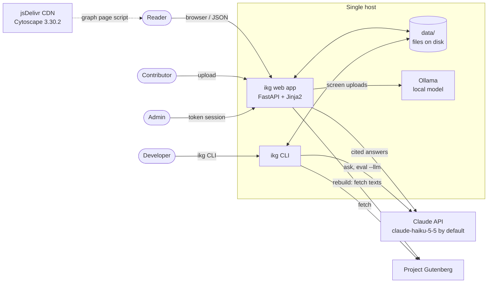
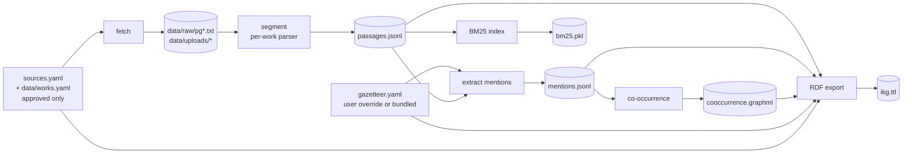
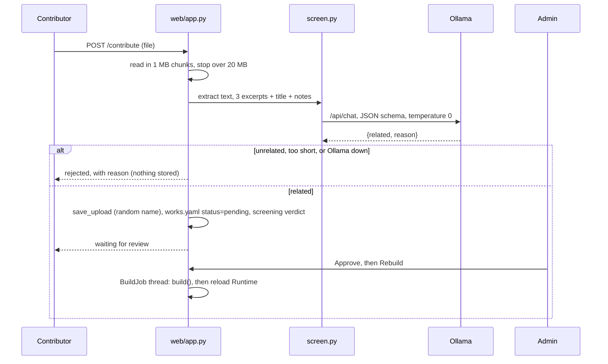

# 02 Architecture

## 1. System context



**External dependencies**

| Dependency | Used for | Needed for |
|---|---|---|
| Project Gutenberg | Downloading bundled and admin-added texts | `fetch` and `build` only. Once files are in `data/raw/`, no network is needed |
| Claude API (`ANTHROPIC_API_KEY`) | Cited answers | Ask mode, `ikg ask`, `ikg eval --llm` |
| Ollama (local) | Relevance screening of uploads | Contributor and admin uploads, unless `IKG_SCREEN=off` |
| jsDelivr | Cytoscape library for the graph page | `/graph` in the browser |

## 2. Components

```mermaid
flowchart TB
    subgraph interfaces[Interfaces]
        cli[cli.py]
        web[web/app.py<br/>routes, auth, rate limit, BuildJob]
        tpl[web/templates + static/graph.js]
    end
    subgraph core[Core library: src/ikg]
        sources[sources.py<br/>work registry, fetch, uploads]
        segment[segment.py<br/>parsers -> Passage]
        normalize[normalize.py<br/>fold, tokenize]
        entities[entities.py<br/>Gazetteer -> Mention]
        retrieve[retrieve.py<br/>BM25 + expansion + boost]
        graph[graph.py<br/>co-occurrence, RDF]
        qa[qa.py<br/>Claude with citations]
        screen[screen.py<br/>Ollama relevance check]
        pipeline[pipeline.py<br/>build, Runtime]
        analysis[analysis.py]
        evaluate[evaluate.py]
        config[config.py]
    end
    cli --> pipeline & retrieve & qa & analysis & evaluate
    web --> pipeline & retrieve & qa & screen & sources & entities
    web --> tpl
    pipeline --> sources & segment & entities & retrieve & graph
    segment --> normalize
    entities --> normalize
    retrieve --> entities
    qa --> retrieve & graph
    evaluate --> retrieve & qa
```

| Module | Responsibility | Depends on |
|---|---|---|
| `config.py` | Paths (overridable with `IKG_DATA`), model IDs, screening settings | none |
| `normalize.py` | Diacritic folding, tokenisation with archaic stopwords, Roman numerals | none |
| `sources.py` | Merges the bundled and user work registries, handles approval status, Gutenberg download and boilerplate stripping, upload storage | `config` |
| `segment.py` | One parser per edition, plus a generic parser; produces `Passage` records | `sources`, `normalize` |
| `entities.py` | Gazetteer loading and validation, regex matching, mention extraction | `segment`, `normalize` |
| `retrieve.py` | BM25 index, query expansion from the gazetteer, entity boost, filters | `entities`, `segment` |
| `graph.py` | Co-occurrence graph (networkx, GraphML) and RDF export (rdflib, Turtle) | `entities`, `segment`, `sources` |
| `qa.py` | Prompt, document blocks, Claude call, citation mapping, abstention | `retrieve`, `graph` |
| `screen.py` | Text extraction, excerpt sampling, Ollama call with a JSON schema, verdict | `sources`, `config` |
| `pipeline.py` | `build()` orchestrates ingestion; `Runtime` loads the built artefacts for queries | all of the above |
| `analysis.py` | Markdown corpus report | `entities`, `segment` |
| `evaluate.py` | Retrieval and answer metrics over `eval/questions.jsonl` | `retrieve`, `qa` |
| `web/app.py` | HTTP routes, admin sessions, rate limiting, background rebuild | `pipeline`, `screen`, ... |
| `cli.py` | `ikg` command | `pipeline`, ... |

The core library has no web dependency. The web app and the CLI are thin layers over the
same functions, so anything the UI does can also be scripted.

## 3. Data flow

### 3.1 Build (offline, deterministic)



`pipeline.build()` runs every step in one pass, in about 10 seconds for the full corpus. It
fails the whole build on a parse error in any work, naming that work, and on duplicate passage
IDs. Nothing in the build calls a model, so builds are reproducible (NFR-2).

A build is **all-or-nothing and self-describing** (L19):

- It holds `processed/.build.lock`, so a CLI build and a web rebuild can't run at the same time.
  A lock older than 30 minutes is treated as left by a crash. Downloads happen before the lock.
- It reads the gazetteer once and saves that text as `processed/gazetteer.yaml`. The runtime and
  `ikg analyze` use this snapshot, never the gazetteer being edited, so editing the gazetteer
  changes nothing until the next build.
- It writes every artefact to a `.tmp` file first. Only when all of them succeeded does it swap
  them in, file by file, and then write the new `manifest.json` with each artefact's SHA-256. A
  failure before the swap leaves the previous build untouched. A failure during it (on Windows,
  another process reading a file, retried for a few seconds first) leaves files from two builds,
  which the old manifest's checksums reject; the build reports an error, and running it again
  recovers. A versioned build directory with a single pointer switch would remove that window;
  it is not needed yet.
- `Runtime.load` verifies every artefact against the manifest and refuses a mismatch (an
  interrupted swap, a hand-edited file, or a build from before this scheme) with a message to
  rebuild. Verification adds about 0.03 s to a 0.5 s load. `ikg stats` and `ikg sparql` verify
  too. If the web app can't load a freshly built corpus, it keeps serving the previous one and
  the rebuild shows as an error.

### 3.2 Query (online)

```mermaid
sequenceDiagram
    participant U as Reader
    participant W as web/app.py
    participant R as retrieve.search
    participant Q as qa.ask
    participant C as Claude API
    U->>W: POST / (q, mode=ask)
    W->>W: clamp k; answer cache hit? return it
    W->>W: check daily budget and rate limit
    W->>Q: ask(question, Runtime)
    Q->>R: search (BM25 + expansion + entity boost + filters)
    R-->>Q: top-k passages
    Q->>Q: graph_context(entities in question)
    Q->>C: passage documents + graph summary (text) + question
    C-->>Q: text blocks with citations
    Q->>Q: map document_index -> passage id, number refs, detect NOT_IN_SOURCES
    Q-->>W: Answer(text, citations, hits, tokens, cost)
    W->>W: charge budget, store in answer cache
    W-->>U: answer + passages given to the model
```

Search mode follows the same path without the Claude call.

### 3.3 Contribution



## 4. Runtime and state

| State | Where | Lifetime | Notes |
|---|---|---|---|
| Built corpus (`Runtime`) | Process memory, loaded from `data/processed/` | Until the next successful rebuild | BM25 index (~30 MB pickle), passages, mentions, graph. All read-only after load |
| Work registry | `data/works.yaml` | Persistent | Written under an in-process lock |
| Gazetteer override | `data/gazetteer.yaml` | Persistent | Falls back to the bundled `src/ikg/data/gazetteer.yaml`. Takes effect at the next build |
| Gazetteer of the current build | `data/processed/gazetteer.yaml` | Until the next build | What `Runtime` and `ikg analyze` use |
| Build lock | `data/processed/.build.lock` | During a build | Shared by the CLI and the web app |
| Uploaded files | `data/uploads/<uuid>.<ext>` | Persistent | |
| Admin sessions | Process memory (dict) | 12 h, lost on restart | |
| Ask rate-limit windows | Process memory | 1 h sliding window | Per client IP; idle clients forgotten |
| Ask spend | Process memory | Current UTC day, lost on restart | Estimated USD, all visitors |
| Answer cache | Process memory | Until the next corpus reload or restart | Up to 1,000 answers |
| Build job state and log | Process memory | Current process | One build at a time (non-blocking lock, plus the build lock file across processes) |

**Consequence:** the web app must run as a **single process with a single worker**. More
workers would each hold their own sessions, rate limits, spend budget and answer cache. (Two
concurrent builds are prevented by the lock file.) Moving this state out of the process is a
roadmap item.

## 5. Deployment

Current supported topology:

```
[browser] --HTTPS--> [reverse proxy on the same host] --HTTP--> [ikg serve, 127.0.0.1:8000]
                                                                  |-- data/ (local disk)
                                                                  |-- Ollama (127.0.0.1:11434)
                                                                  `-- Claude API (outbound HTTPS)
```

- `ikg serve` binds `127.0.0.1` by default. Put a reverse proxy (Caddy, nginx) in front for
  HTTPS. uvicorn trusts `X-Forwarded-For` from 127.0.0.1, so per-client rate limits work.
- Configuration is through environment variables only (listed in [05](05-interfaces.md#4-environment-variables)).
- There is no container image yet; see [06](06-roadmap.md).

**Continuous integration** (`.github/workflows/ci.yml`, GitHub Actions) runs on every pull
request and on pushes to `main`:

| Job | What it does | Fails when |
|---|---|---|
| `tests` | `pytest` on Python 3.10 and 3.12; no network or API key | Any test fails |
| `eval-gate` | Fetches the bundled Gutenberg texts and verifies their checksums (cached on `sources.yaml`), runs `ikg build`, then `ikg eval --check eval/baseline.json` | An offline retrieval metric falls below the committed baseline |

The gate covers offline retrieval metrics only. Answer-level metrics (`--llm`) call the Claude
API and are not run in CI.

## 6. Key decisions

| # | Decision | Why | Trade-off |
|---|---|---|---|
| D1 | Deterministic, gazetteer-based entity extraction rather than an LLM or NER model | Every mention traces to an exact surface form, builds are reproducible, and evaluation can separate retrieval errors from extraction errors | Recall is limited to curated aliases; no pronouns or epithets beyond the list |
| D2 | Model translator renderings explicitly | Keeps translation choices visible: Ganguli's "righteousness" is recorded as a rendering of *dharma*, not as *dharma* itself | Renderings like "duty" also match non-technical uses (precision cost) |
| D3 | Sparse BM25 with gazetteer expansion, not dense embeddings | No GPU or model in the build, inspectable expansion terms, millisecond queries | Weaker on paraphrase; expansion shows no measurable gain on the current eval set (06 §1) |
| D4 | Claude's native document citations | Citations are produced by the API rather than parsed from text, and map exactly to a passage | Depends on one provider's API |
| D5 | Passage-level co-occurrence graph rather than extracted relations | Cheap, complete, and reproducible; good for exploration and orientation | Edges say "appear together", not how they are related |
| D6 | Files on disk (JSONL, YAML, pickle, GraphML, Turtle), no database | Zero setup, easy to diff and inspect, fast full rebuilds | Single-host, single-writer; registry writes need a lock |
| D7 | Admin approval gate plus local-model screening for uploads | Keeps the corpus curated; screening keeps uploaded content on the host and costs nothing per check | Screening can be fooled; it filters, it does not replace review |
| D8 | Separate `kind` for commentary, introductions and scholarship | Lets answers and filters separate the text from what people said about it | Parsers must classify correctly; the generic parser takes one kind per upload |

### Decided 2026-10-23: D10 and D11 implemented, D9 and D12 not yet

These follow the [2026-10-23 review](reviews/2026-10-23-architecture-review.md) (B1, B2, B4, B5)
and were agreed before eval growth, because eval items, curated claims and RDF IRIs all key
on them. Each is a roadmap row in [06 §5](06-roadmap.md#phase-0-measure-and-harden-t10). D10 and
D11 are in the code; until D9 and D12 are done, the namespace is still `example.org` and there
is still one shared admin token.

| # | Decision | Why | Consequences |
|---|---|---|---|
| D9 | **Permanent namespace on w3id.org.** Ontology terms under `https://w3id.org/ikg/ns#`, instances under `https://w3id.org/ikg/id/`. The ontology carries an `owl:versionIRI` | w3id gives a permanent redirect that can be re-pointed without breaking IRIs; it is the usual choice for academic ontologies | A one-time registration PR to the w3id repository (perma-id/w3id.org) by a maintainer. Replaces `example.org` (L13) |
| D10 | **Implemented.** **Separate text from translation.** `Passage.work` is the text (e.g. `mahabharata`); `Passage.edition` is the translation (e.g. `ganguli-1883`). Registry entries describe editions and name their work | A second translation of the same text must not become a new work; translator comparison (C2) and parallel translations (Phase 1) need it | Gazetteer `works` scoping and graph `weight_<work>` stay per text. Citations, RDF `Edition` and `Rendering` become per edition (renderings keyed by edition, concept and surface, L29) |
| D11 | **Implemented.** **Freeze today's passage IDs as v1, and add a locator.** Existing IDs stay exactly as they are; the chunking parameters that produce them (`MAX_CHARS = 1500`, the sentence splitter) are frozen and recorded. A second edition of a text sets its own ID prefix (`id_prefix`), or the build stops on duplicate IDs. A structured `locator` field holds book/section/verse, page, or timestamp for citations | No migration of the 28 eval items or the fidelity drafts; IDs no longer depend on accidental chunker changes; pages and timestamps fit (Phase 1) | Changing the chunker for an existing edition needs an explicit ID migration map. Eval expectations move to section level using the locator (B3) |
| D12 | **Named curator tokens and an append-only provenance log before Phase 2.** Each curator gets a named token in place of the single admin token; every approval, edit and rejection is appended to a log with who, when, what and the supporting passage | Curation provenance ("who proposed, who approved") is correct from the first record | OIDC and roles still come in Phase 4 and replace the tokens; the log format carries over |

### Decided and implemented (2026-10-23)

| # | Decision | Why | Trade-off |
|---|---|---|---|
| D13 | **Answer with Claude Haiku 5.5 at effort `low` by default**; Opus 5.5 and Sonnet 5.5 stay selectable (`IKG_ANSWER_MODEL`, `IKG_ANSWER_EFFORT`) | The agreed bar for a cheaper default: citation metrics within 5 points of Opus 5.5 at effort `high`, adversarial abstention no lower, false abstentions no higher. On the 28-item eval (one run each) Haiku met it: citing the right book 0.917 vs 0.917, citation precision 0.747 vs 0.702, abstaining on unanswerable questions 1.0 vs 1.0, false abstentions 0.083 vs 0.167 (2 vs 4 of 24), at $0.0012 instead of $0.051 a question | One run per setting, and the differences are 1–2 items; Opus was tried only at `high`. The eval checks books, not exact passages, and doesn't yet measure SOT fidelity (C1), where a larger model may matter. Re-run the comparison, several times, when the fidelity benchmark exists. Haiku has no server-side refusal fallback |

## 7. Technology stack

What the project uses today. Anything not listed here is not used. Planned technologies
(vector store, database, OIDC, triple store, Whisper, Docker) are in [06](06-roadmap.md)
and are not part of the system until they appear in this table.

| Layer | Technology | Version / setting | Where | Notes |
|---|---|---|---|---|
| Language | Python | 3.10+ (CI tests 3.10 and 3.12) | everywhere | Packaged with setuptools (`pyproject.toml`), console script `ikg` |
| Configuration | python-dotenv | ≥ 1.0 | `cli.py`, `config.py` | `.env` loaded from the working directory upwards; shell variables take precedence |
| Source texts | Project Gutenberg plain text, fetched with `requests` | ≥ 2.31 | `sources.py`, `sources.yaml` | Seven files, about 18 MB, each pinned by SHA-256; network needed only for `fetch`/`build` |
| Uploads | `.txt`, `.md`, `.pdf` (text layer via pypdf) | pypdf ≥ 4.0 | `sources.py`, `segment.parse_generic` | No OCR, EPUB or DOCX yet |
| Segmentation and entity extraction | Python `re`, curated YAML gazetteer (PyYAML) | PyYAML ≥ 6.0 | `segment.py`, `entities.py`, `normalize.py` | Deterministic; no NLP or NER library |
| Retrieval | BM25 implemented in the project (k1 = 1.5, b = 0.75), stored as a pickle | none (no search library) | `retrieve.py` | Gazetteer query expansion and entity boost; no embeddings or vector store |
| Knowledge graph | networkx co-occurrence graph, saved as GraphML | networkx ≥ 3.0 | `graph.py` | Not a graph database |
| Ontology and linked data | OWL ontology in Turtle; RDF export and SPARQL with rdflib | rdflib ≥ 7.0 | `ontology/ikg.ttl`, `graph.to_rdf`, `ikg sparql` | Namespace is the placeholder `https://example.org/ikg#` (L13) |
| Answer generation | Claude API through the `anthropic` SDK, native document citations | `claude-haiku-5-5` at effort `low` by default (D13); configurable | `qa.py`, `config.py` | Needs `ANTHROPIC_API_KEY`; the only paid call. Cost estimated per answer from `config.PRICES` |
| Upload screening | Ollama (local) over HTTP | default model `qwen3.5:9B` | `screen.py` | Runs on the host; uploads are rejected if Ollama is unreachable |
| Web app | FastAPI, served by uvicorn; Jinja2 templates; python-multipart for forms | FastAPI ≥ 0.110, uvicorn ≥ 0.29, Jinja2 ≥ 3.1 | `web/app.py`, `web/templates/` | `[web]` extra. Sessions, rate limits and the build job live in process memory |
| Graph explorer | Cytoscape.js from the jsDelivr CDN | 3.30.2 | `web/templates/graph.html`, `web/static/graph.js` | Only browser dependency |
| Storage | Files on disk: JSONL, YAML, pickle, GraphML, Turtle, JSON (build manifest) | none | `data/` (D6) | No database |
| Tests | pytest; httpx for FastAPI's `TestClient` | pytest ≥ 7.0, httpx ≥ 0.27 | `tests/` | Models and HTTP are faked; no network or key needed |
| Evaluation | `ikg eval` with committed baselines | `eval/baseline.json` (offline, CI), `eval/baseline-llm.json` (answers, by hand) | `evaluate.py` | `--check` is the regression gate |
| CI | GitHub Actions | `actions/checkout@v4`, `setup-python@v5`, `cache/restore@v4`, `cache/save@v4` | `.github/workflows/ci.yml` | See §5 |
| Code review | Independent review by a Fable subagent before each PR | `.claude/agents/fable-reviewer.md` | PR template | See ONBOARDING §7 |
| Docs and diagrams | Markdown with Mermaid | none | `docs/` | Render on GitHub |
