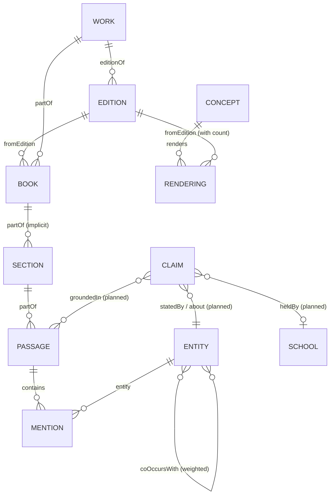

# 04 Data model

## 1. Conceptual model



- **Passage kinds** are subclasses of `ikg:Passage`. `Verse` and `Narrative` are primary text;
  `Commentary`, `Introduction` and `Secondary` are not.
- **Entity types** are subclasses of `ikg:Entity`: `Person`, `Deity`, `Place`, `Concept`,
  `SchoolOfThought`.
- A **work** is the text (the Mahabharata); an **edition** is one translation of it (Ganguli's).
  Passages record both (D10). Filters, gazetteer scoping and graph weights are per work; books,
  mentions, renderings and citations are per edition, so two translations stay comparable.
- A `Rendering` is an English word that an edition uses for a Sanskrit `Concept`: one per
  (edition, concept, word), with `ikg:count` for how often that edition uses it. It is a
  separate class, so translation choices are data rather than being merged into the concept.
  Renderings listed in the gazetteer but never used by an edition are not exported.
- A `Mention` records *via* `alias` or `rendering`.
- `Claim`, `statedBy`, `heldBy`, `groundedIn` and `about` are reserved for curated propositions
  ("Yama teaches that the atman is unborn", stated by Yama, grounded in `upa.katha.p1.v18`).
  The ontology defines them but nothing generates them yet.

The full ontology is in `ontology/ikg.ttl` (OWL, 96 lines).

## 2. Identifiers

| Thing | Format | Example |
|---|---|---|
| Work | slug, from the registry (`work:`, defaulting to `id`) | `mahabharata`, `gita_notes` |
| Edition | slug, from the registry (`edition:`, defaulting to `id`); unique | `ganguli-1883`, `gita_notes` |
| Mahabharata passage | `mbh.b<book:02>.s<section:03>.p<chunk:02>` | `mbh.b05.s033.p02` |
| Ramayana passage | `ram.b<book>.c<canto:03>.p<chunk:02>` | `ram.b4.c012.p01` |
| Upanishad verse | `upa.<name>.p<part>.v<verse:02>` | `upa.katha.p1.v19` |
| … its commentary | `<verse id>.c<n>` | `upa.katha.p1.v19.c1` |
| … introduction / preamble | `upa.<name>.intro<nn>`, `upa.<name>.p<part>.pre<nn>` | `upa.kena.intro01` |
| … peace chant | `upa.<name>.peace`, `.peace-close` | `upa.isa.peace` |
| Vishnu Purana passage | `vp.b<part>.s<section:03>.p<chunk:02>` | `vp.b1.s012.p01` |
| Generic (added) passage | `<work>.f<file>.b<book>.s<section:03>.p<chunk:02>` | `gita_notes.f1.b1.s002.p01` |
| Entity | gazetteer `id` | `krishna`, `dharma`, `bharata_ram` |
| RDF instance | `https://example.org/ikg/data/<kind>/<id>` | `d:entity/krishna`, `d:edition/ganguli-1883`, `d:book/ganguli-1883/05`, `d:rendering/ganguli-1883/dharma/righteousness`, `d:mention/dharma/ganguli-1883/12/rendering` |

IDs are hierarchical, so a prefix selects a unit: `mbh.b12` is the Shanti Parva and
`upa.katha` is the Katha Upanishad. The evaluation set relies on this.

**Passage ID scheme v1 is frozen (D11).** The `.p<chunk>` part depends on the chunking
parameters (`MAX_CHARS = 1500`, the sentence splitter and the packing in `segment.chunk`), so
they may not change for an existing edition without an explicit ID migration map. A snapshot
test pins the chunks v1 makes of a fixed text and the splitter pattern, and every build records
`MAX_CHARS` and the pattern in `processed/manifest.json`. The ID prefix comes from the registry
entry's `id_prefix`, defaulting to the parser's own (`mbh`, `ram`, `upa`, `vp`) or, for the
generic parser, the entry's `id`. A second edition of a bundled text must set its own
(e.g. `id_prefix: mbhd`); otherwise the build stops on duplicate passage IDs, so IDs never
collide silently. Where a passage sits in its edition, for citations, is in its `locator`
(§4), not parsed from the ID.

**v1 errata.** Corrections of segmentation defects change IDs only where the old ones were
wrong, and are listed here:

| Date | Change | IDs |
|---|---|---|
| 2026-10-23 | Translator footnotes at the end of 11 Mahabharata parvas had been chunked into the parva's last section; they are no longer passages. The last real chunk of each such section lost the footnote text appended to it | 656 removed: `mbh.b12.s365.p05`–`p377`, `mbh.b13.s168.p05`–`p107`, `mbh.b06.s124.p06`–`p66`, `mbh.b14.s092.p10`–`p48`, `mbh.b07.s203.p02`–`p25`, `mbh.b03.s313.p04`–`p20`, `mbh.b15.s039.p06`–`p15`, `mbh.b05.s199.p05`–`p13`, `mbh.b04.s072.p07`–`p14`, `mbh.b02.s080.p06` |
| 2026-10-23 | The Kena's "Part fourth" heading was not recognised, so Part 4 was missing and its commentaries were filed under Part 3 verses | Added `upa.kena.p4.v01`–`v09` and their commentaries (16 passages); removed the 13 misfiled `upa.kena.p3.v01.c2`…`p3.v09.c*` commentaries |

## 3. Files on disk

All paths are under `IKG_DATA` (default `data/`) unless noted.

| Path | Format | Written by | Read by | In git |
|---|---|---|---|---|
| `src/ikg/data/sources.yaml` | YAML | developers | `sources` | yes |
| `src/ikg/data/gazetteer.yaml` | YAML | developers | `entities` (fallback) | yes |
| `ontology/ikg.ttl` | Turtle/OWL | developers | people, SPARQL tools | yes |
| `eval/questions.jsonl` | JSONL | developers | `evaluate` | yes |
| `eval/baseline.json` | JSON | developers | `eval --check`, CI | yes |
| `processed/manifest.json` | JSON | `build` | people, future builds | no |
| `works.yaml` | YAML | web admin / contribute | `sources` | no |
| `gazetteer.yaml` | YAML | web admin gazetteer editor | `entities` (takes precedence) | no |
| `raw/pg<n>.txt` | Gutenberg text | `fetch` | `segment` | no |
| `uploads/<uuid32>.<txt\|md\|pdf>` | as uploaded | web uploads | `segment` | no |
| `processed/passages.jsonl` | JSONL, one `Passage` per line | `build` | `ikg stats`, `analyze` | no |
| `processed/mentions.jsonl` | JSONL, one `Mention` per line | `build` | `Runtime`, `analyze` | no |
| `processed/bm25.pkl` | Python pickle of `BM25Index` (with passages) | `build` | `Runtime` | no |
| `processed/cooccurrence.graphml` | GraphML | `build` | `Runtime` | no |
| `processed/ikg.ttl` | Turtle | `build` | `ikg sparql` | no |
| `reports/corpus-analysis.md` | Markdown | `analyze` | people | yes |
| `eval/results/run-*.json` | JSON | `eval` | people | no |

`bm25.pkl` is a pickle. Only load files this application wrote itself; never accept one from
elsewhere.

## 4. Record schemas

### Passage (`passages.jsonl`)

```json
{"id": "upa.katha.p1.v19", "work": "upanishads", "book": "katha", "book_label": "Katha Upanishad",
 "section": 1, "section_label": "Part 1, Verse 19", "ordinal": 19, "kind": "verse",
 "text": "O Nachiketas, this is thy fire that leads to heaven...", "translator": "Swami Paramananda",
 "source_url": "https://www.gutenberg.org/ebooks/3283", "work_title": "Upanishads",
 "edition": "paramananda-1919", "locator": {"upanishad": "katha", "part": 1, "verse": 19}}
```

| Field | Type | Notes |
|---|---|---|
| `id` | string | Unique within the corpus; the build fails on duplicates |
| `work` | string | Work ID |
| `book`, `book_label` | string | Top-level unit: parva, kanda, Upanishad, Purana part, or generic level 1 |
| `section`, `section_label` | int, string | Second-level unit |
| `ordinal` | int | Chunk number within the section (the verse number for Upanishad verses) |
| `kind` | enum | `verse`, `narrative`, `commentary`, `introduction`, `secondary` |
| `text` | string | At most ~1,500 characters |
| `translator` | string | From the work registry: translator or author |
| `source_url` | string | Gutenberg ebook URL or `upload:<original name>` |
| `work_title` | string | Display title |
| `edition` | string | Edition ID: the translation this passage comes from (D10) |
| `locator` | object | Position in the edition, for citations (D11). Keys by parser: Mahabharata `book`, `section`; Ramayana `book`, `canto`; Upanishads `upanishad`, `part`, `verse` (a number, or `peace`/`peace-close`; commentary shares its verse's); Vishnu Purana `part`, `section`; generic `file`, `book`, `section`. Planned: `page` for books, `start`/`end` seconds for recordings |

### Mention (`mentions.jsonl`)

```json
{"entity": "dharma", "passage": "mbh.b12.s059.p03", "work": "mahabharata", "surface": "righteousness", "via": "rendering"}
```

### Work registry entry (`sources.yaml`, `works.yaml`)

An entry is one edition. `work` and `edition` default to `id`. Registry IDs and edition IDs must
be unique across both registries, and a `work:` value must be the `id` of an existing work, or
loading fails. So does malformed YAML, an unknown or missing field, or a `works:` that is not a
list of entries; every such error names the file and entry, and the web app shows it as a notice. Bundled Gutenberg files carry `sha256: <hex>` next to `gutenberg: <id>`; `fetch` and `build`
refuse a file whose contents differ.

```yaml
- id: gita_notes                 # unique slug (the registry key)
  work: gita_notes               # optional: the text; set to an existing work id for a second translation
  edition: gita_notes            # optional: the edition id; must be unique
  id_prefix: ""                  # optional: passage ID prefix; required for a second edition of a bundled text
  title: Gita notes
  translator: A. Scholar         # translator or author
  year: "2024"
  parser: generic                # mahabharata | ramayana | upanishads | vishnu_purana | generic
  files:
    - upload: 3f2a...c9.md       # or: gutenberg: 15474
      original_name: notes.md
  notes: ""                      # contributor's notes to the reviewer
  status: pending                # pending | approved | rejected (bundled works: approved)
  kind: secondary                # passage kind used by the generic parser
  submitted_by: someone@example.org
  submitted_at: "2026-10-23 15:40"
  screening: "qwen3.5:9B: It discusses Krishna and dharma."   # uploads only
```

### Gazetteer entry

```yaml
- id: dharma                     # stable, used in graph and RDF
  type: Concept                  # Person | Deity | Place | Concept | SchoolOfThought
  label: Dharma
  iast: dharma                   # optional
  aliases: [dharma]              # case-insensitive
  aliases_cs: []                 # case-sensitive (e.g. [Self] for atman)
  renderings: [righteousness, duty, duties]   # translator's English words
  works: []                      # optional: restrict all forms to these works
  aliases_by_work: {}            # optional: {ramayana: [rama]}
```

Unknown fields, duplicate IDs and wrongly typed fields (a string where a list is expected, a
`type` that is not an entity type) are rejected when the gazetteer is loaded. A key left blank
(`iast:`) counts as not set. So is a surface
form listed under two entities, unless their `works` scopes are disjoint ([03 §4.2](03-design.md#42-matching)).

### Graph (GraphML)

| Element | Attributes |
|---|---|
| Node (entity ID) | `type`, `label`, `mentions` (int), `works` (`"work:count;work:count"`) |
| Edge | `weight` (shared passages), `weight_<work>` (shared passages in that work) |

### Evaluation item (`eval/questions.jsonl`)

```json
{"id": "mbh-04", "type": "retrieval", "question": "How did Karna die when the wheel of his chariot sank into the earth?", "expected": ["mbh.b08.s090", "mbh.b08.s091"]}
{"id": "adv-02", "type": "adversarial", "question": "What does the Kena Upanishad say about the battle of Kurukshetra?", "expected": [], "works": ["upanishads"]}
```

### Evaluation baseline (`eval/baseline.json`)

The metrics CI holds the project to (`ikg eval --check`). `k` must match the run's `-k`, and
every key under `metrics` must not get worse, item counts included. `description` and
`recorded` are for readers.

```json
{"description": "...", "recorded": "2026-10-23", "k": 8,
 "metrics": {"n_retrieval": 24, "n_adversarial": 4, "retrieval_hit_at_1": 0.292, "retrieval_hit_at_k": 0.792,
             "retrieval_mrr": 0.502}}
```

## 5. Example SPARQL

```sparql
# How each edition renders each concept, most used first
SELECT ?concept ?edition ?word ?n WHERE {
  ?r a ikg:Rendering ; ikg:renders ?c ; ikg:surface ?word ; ikg:fromEdition ?e ; ikg:count ?n .
  ?c rdfs:label ?concept . ?e rdfs:label ?edition .
} ORDER BY ?concept DESC(?n)
```

For *dharma*: Ganguli's Mahabharata uses "duties" 1,302 times, "righteousness" 913 and "duty"
617; Griffith's Ramayana "duty" 214; Dutt's Vishnu Purana "duties" 37 and "duty" 18.

```sparql
# Books where Dharma is mentioned through a rendering, most first
SELECT ?book ?n WHERE {
  ?m a ikg:Mention ; ikg:entity <https://example.org/ikg/data/entity/dharma> ;
     ikg:via "rendering" ; ikg:inUnit ?b ; ikg:count ?n .
  ?b rdfs:label ?book .
} ORDER BY DESC(?n)
```

Top results: Book 12 (Santi Parva) 1,324, Book 13 (Anusasana Parva) 636.

`ikg sparql` adds the `ikg:` and `rdfs:` prefixes automatically when a query does not start
with `PREFIX`. Instance IRIs contain `/`, which is not allowed in a SPARQL prefixed name, so
write them in full as above.
