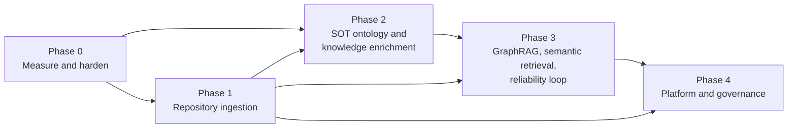

# 06 Roadmap: current limits and future expansion

This document records what the system does well today, where it is measurably weak, which
target capabilities are done, partial or not started, the original contributions the
project aims to make, and a phased plan for extending it.
Each phase lists the extension points in the code, so the work can be scoped from here.

## 1. Measured baseline

Offline retrieval evaluation, 86 questions (71 retrieval, 15 adversarial), `k = 8`. Each item's
`expected` names the section or verse that answers it, checked by reading the passages and
reviewed independently; only primary text (verse, narrative) counts as a hit, not commentary on
it. Before 2026-10-23, `expected` named only the book, and the set had 28 items.

| Configuration | hit@1 | hit@8 | MRR |
|---|---|---|---|
| BM25 + gazetteer expansion + entity boost (default) | 0.282 | 0.620 | 0.423 |
| BM25 only (`ikg eval --no-expand`) | 0.296 | 0.620 | 0.420 |
| *Original 24 items, book-level (old)* | *0.625* | *0.958* | – |

By question type (default configuration; `ikg eval` prints this as `retrieval_by_type`):

| Type | Items | hit@1 | hit@8 | MRR |
|---|---|---|---|---|
| `xw` same story in two or three works | 7 | 0.71 | 1.00 | 0.86 |
| `mbh` Mahabharata episodes | 6 | 0.50 | 1.00 | 0.75 |
| `ram` Ramayana episodes | 8 | 0.38 | 0.88 | 0.58 |
| `upa` Upanishads | 7 | 0.29 | 0.71 | 0.50 |
| `vp` Vishnu Purana | 7 | 0.14 | 0.71 | 0.41 |
| `spk` what a named speaker says | 16 | 0.25 | 0.50 | 0.34 |
| `con` concepts | 5 | 0.20 | 0.60 | 0.32 |
| `skt` phrased with the Sanskrit term the translation renders in English | 15 | 0.07 | 0.20 | 0.11 |

What this shows:

- **Finding the answering passage is much harder than finding the right book**, and narrative
  episodes are the easy case. Retrieval misses 27 of 71 items entirely. Questions that name no work
  can be answered by another telling (the Mahabharata's Ramopakhyana, the Vishnu Purana's Krishna
  stories, a second telling in another parva), and `expected` includes those.
- **Sanskrit-phrased questions are the weakest** (C2): 12 of 15 miss. Gazetteer expansion is what
  finds the other 3 (without it, 1 of 15); overall it is neutral on hit@8 and slightly better on
  MRR, and costs hit@1 (D3). The evidence for semantic retrieval (Phase 3) is now concrete. `skt` items carry no
  English gloss, and a term the translator keeps in Sanskrit (Paramananda's "Atman", "Vidya")
  makes a `upa` item, not a `skt` one.
- **Speaker questions miss half the time** (8 of 16): without speaker attribution (L2), "what
  does Kunti tell Karna" retrieves battle passages that name Karna.
- **For the Upanishads, commentary outranks the verse** (L36): Paramananda's commentary is longer
  and wordier than the verse, so BM25 ranks it higher.
- The Gutenberg source itself lacks a few section headings (Sabha Parva LXVII; Shanti Parva
  XXXIV–XXXV and CCCLXIV), so those numbers don't exist in the corpus.

**Answers** (`ikg eval --llm`, the original 28 items with book-level expectations, k = 8, 2026-10-23; total spend $1.50):

| Model, effort | cites_expected | citation_precision | adversarial_abstain | false_abstain | Output tokens | Cost / question |
|---|---|---|---|---|---|---|
| Opus 5.5, high | 0.917 | 0.702 | 1.0 | 0.167 | 1,140 | $0.051 |
| Haiku 5.5, medium | 0.917 | 0.735 | 1.0 | 0.083 | 1,166 | $0.0013 |
| **Haiku 5.5, low (default, D13)** | 0.917 | 0.747 | 1.0 | 0.083 | 925 | **$0.0012** |

Every question sends about 7,000 input tokens (eight passages). Haiku 5.5 at low effort met
the agreed bar (citation metrics within 5 points of Opus 5.5 high, adversarial abstention no
lower, false abstentions no higher), so it is the default (D13). One run per setting: the
differences are 1–2 items. Caveats: the set is small, these runs used the old book-level
expectations, and it doesn't test SOT fidelity; re-run when the fidelity benchmark exists.

**Current answer baseline** (Haiku 5.5 low, the first 57 items, section-level expectations, 2026-10-24,
$0.063; `eval/baseline-llm.json`):

| cites_expected | citation_precision | has_citations | false_abstain | adversarial_abstain | Cost / question |
|---|---|---|---|---|---|
| 0.660 | 0.463 | 0.787 | 0.277 | 1.0 | $0.0011 |

`cites_expected` tracks retrieval hit@8 (both 31 of 47): 30 of the 31 retrieval hits were cited
(`upa-03` abstained), and one miss (`upa-01`) counted because the model cited commentary on the
expected verse, which the retrieval metric excludes. Of the 16 retrieval misses, 10 abstained
and 5 answered citing only wrong passages (`vp-01`, `con-04`, `skt-05`, `spk-05`, `spk-06`). The 13
false abstentions are those 10 plus 3 items where retrieval had hit (`upa-02`, `upa-03`, `xw-04`).
Retrieval is the bottleneck; answering from wrong passages on a miss is the next problem (L37).
Measured with the earlier book-level expectations: retrieval with k = 4 still reached hit@k 0.958 (k = 3: 0.917), but answers got worse: with
k = 4, cites_expected fell to 0.833 and false abstentions rose to 0.167, at $0.00079 a question.
k stays 8 (Phase 0 row "Send fewer passages"). Book-level hit@k can't tell whether the model
has enough supporting passages to answer.

The default retrieval row is committed as `eval/baseline.json`. CI rebuilds the corpus on every pull
request and fails if either number drops ([03 §11](03-design.md#11-evaluation-evaluatepy)).

What this shows:

- **Retrieval nearly always finds the right part of the text** (23 of 24 within the top 8), but
  ranks it first only 62% of the time.
- **Gazetteer expansion shows no measurable benefit on this set.** Most questions already use the
  same words as the translation ("Karna", "wheel", "chariot"). Only 5 questions target concepts,
  and none is phrased in Sanskrit where the translation uses an English rendering, which is the
  case the expansion is for. The set is too small and not targeted enough to support or reject
  design decision D3.
- **The single miss (`con-02`, "the dharma of a kshatriya on the battlefield according to
  Krishna")** retrieves Bhishma's teaching in the Shanti Parva instead of the Bhagavad Gita
  (Book 6). The system has no notion of *who is speaking*, so "according to Krishna" adds
  nothing to the query.
- **Answer-level metrics have never been recorded.** `ikg eval --llm` exists, but there is no
  baseline for citation precision or abstention.

Graph structure: 75 entities with 1,903 edges, a **density of 0.69**. Passages of up to 1,500
characters are large enough that most major figures co-occur somewhere, so an edge alone
carries little information. Only 344 edges have weight ≥ 50. The explorer works around this
by starting at a minimum of 10 shared passages (the API default is 5).

## 2. Known limitations

| # | Limitation | Effect | Where |
|---|---|---|---|
| L1 | Eval set is still small (86 items; target about 150) and written without SMEs | Small retrieval changes move the rates by one item (about 2 points) and can't be judged; no gold answers yet. Rendering-targeted, speaker and cross-work items now exist (batch 1, 2026-10-23) | `eval/questions.jsonl` |
| L2 | No speaker attribution | Questions like "according to Krishna" can't be answered precisely; answers can't say who said what | `segment.py`, `Passage` |
| L3 | Small gazetteer: 76 entities, a fraction of the named figures | Low extraction recall; most minor figures are invisible to the graph | `gazetteer.yaml` |
| L4 | No epithet or pronoun resolution beyond listed aliases | "the son of Pritha", "he" are not linked | `entities.py` |
| L5 | One entity per surface form | **Resolved (Oct 2026):** a form claimed by two entities in overlapping works is rejected on load, naming both, including case-sensitive/insensitive clashes. Entities in disjoint works may share a form; in a question with no work such a form links to neither | `Gazetteer.__init__` |
| L6 | Renderings like "duty" also match non-technical uses | Inflated concept counts; precision not measured | `gazetteer.yaml` |
| L7 | Co-occurrence only, no typed relations or claims | Graph answers "appear together", not "teaches", "son of", "fights" | `graph.py`, ontology `Claim` |
| L8 | Dense graph (0.69), raw counts as weights | Common figures dominate; weak edges are noise | `build_cooccurrence` |
| L9 | Sparse retrieval only | Paraphrased questions that share few words with the passage are missed | `retrieve.py` |
| L10 | State in process memory (sessions, rate limits, build job) | Single worker only; restart logs the admin out | `web/app.py` |
| L11 | One shared admin token, no roles or audit log | **Partly resolved (Oct 2026, D12):** named curator tokens and an append-only provenance log. Still open: roles (every curator is a full admin) and real identity (OIDC, Phase 4) | `web/app.py` |
| L12 | YAML registry and file storage | Single host, single writer | `sources.py` |
| L13 | Placeholder RDF namespace `example.org` | RDF IRIs are not stable or resolvable | `graph.py`, `ontology/ikg.ttl` |
| L14 | `Advaita` (SchoolOfThought) has renderings, but `ikg:renders` has range `Concept` | Exported RDF is slightly inconsistent with the ontology | `gazetteer.yaml`, ontology |
| L15 | Test and CI gaps | **Mostly resolved (Oct 2026):** RDF export, analysis report and CLI `search`/`stats` are tested, and CI runs `pytest` plus the offline eval gate. Still open: answer-level metrics are not gated, and `fetch`/`ask`/`sparql`/`serve` have no CLI-level tests | `tests/`, `.github/` |
| L16 | Generic parser applies one `kind` to a whole upload | A book mixing translation and commentary can't be separated | `parse_generic` |
| L17 | Scanned PDFs (no text layer) are rejected | Some scholarship can't be contributed | `screen.py`, `read_source` |
| L18 | Gutenberg texts added by an admin are not screened | Depends on admin judgement | `/admin/gutenberg` |

L19–L30 come from the [2026-10-23 architecture review](reviews/2026-10-23-architecture-review.md)
(IDs A1–A10, B1–B7 there). B3 (book-level expectations) was fixed on 2026-10-23: expectations
are now section- or verse-level, and MRR is reported.

| # | Limitation | Effect | Where |
|---|---|---|---|
| L19 | Builds are not self-describing or atomic: the runtime loads the current gazetteer, not the build's; artefacts are written in place; CLI and web builds don't share a lock (A1, A6) | **Resolved (Oct 2026):** the build snapshots its gazetteer, swaps artefacts in only after all succeeded, writes a manifest with checksums last, and holds a lock shared by the CLI and the web app; `Runtime` refuses mismatched artefacts | `pipeline.py` |
| L20 | The graph summary was sent to Claude as a citable document (A2) | **Resolved (Oct 2026):** it is now a plain text block labelled not-a-source, and the prompt forbids stating anything only it supports. Sentence-level verification (Phase 3) is still needed to prove it | `qa.py` |
| L21 | API spend was limited per client address only; Ask ran on GET (A3) | **Resolved (Oct 2026):** POST-only Ask, an answer cache, a daily budget across all visitors, idle limiter keys expire, and a 44× cheaper default model. Spend state is in memory, so a restart resets the day's total (L10) | `web/app.py`, `qa.py` |
| L22 | The gazetteer validator doesn't check field types or the `type` value (A4) | **Resolved (Oct 2026):** field types, the `type` value and `aliases_by_work` shape are checked; a slip like `aliases: krishna` is rejected with the entity and field named | `entities.py` |
| L23 | Uploads have no rate limit; PDFs are parsed in the web worker (A5) | **Resolved (Oct 2026):** a middleware refuses over-limit or oversized uploads before the body is received; PDFs are parsed in a child process with a time limit, page and text caps, a memory cap on POSIX, two at a time, and no secrets in its environment; a failed registration deletes the saved file | `web/app.py`, `screen.py` |
| L24 | Source downloads are not pinned by checksum (A7) | **Resolved (Oct 2026):** bundled texts carry a `sha256` in `sources.yaml`, verified by `fetch` and `build`; downloads retry. Admin-added Gutenberg texts are not pinned yet | `sources.py` |
| L25 | Non-ASCII tokens crashed the login and contribute checks (A8) | **Resolved (Oct 2026):** tokens are compared as bytes | `web/app.py` |
| L26 | Small robustness gaps (A9, A10) | **Resolved (Oct 2026):** truncated answers are flagged; `primary_only` must be a boolean; admin `/api/` routes answer 401 (and the build poller follows it to the login page); a Gutenberg start marker on the last line no longer raises | `web/app.py`, `sources.py` |
| L27 | Work and edition are not separated in the data model (B1) | **Resolved (Oct 2026, D10):** passages, the registry and RDF separate the text (`work`) from the translation (`edition`); books, mentions and renderings are per edition | `Passage`, IRIs, gazetteer |
| L28 | Passage IDs include a chunk ordinal that depends on chunking parameters (B2) | **Resolved (Oct 2026, D11):** v1 IDs are frozen (chunking parameters pinned by a test and recorded in the build manifest); positions for citations come from the new `locator` field | `segment.py` |
| L29 | The RDF shape lacks passages by default, `Section` instances, per-edition renderings and `ordinal` (B4) | **Partly resolved (Oct 2026):** renderings are now per edition with counts. Still open: passages only with `--with-passages`, no `Section` instances, `ordinal` not exported, placeholder namespace (D9) | `graph.py`, ontology |
| L30 | Curation provenance and copyrighted ingestion are planned before identity and roles (B5) | **Partly resolved (Oct 2026):** named curators and the provenance log (D12, L11) record who proposed and who approved; roles and real identity (Phase 4) are still needed before copyrighted material is served | Phases 1, 2, 4 |
| L31 | When a refusal fallback answers (Opus or Sonnet only), cost is estimated from the final model's usage alone; the declined attempt (`usage.iterations`) is not added, and an unpriced fallback model is charged a flat $0.25 | Budget under- or over-estimates in rare cases; not relevant to the Haiku default | `qa.py`, `config.PRICES` |
| L32 | The daily budget is checked before a call and charged after it | Concurrent requests can overshoot the budget by their combined cost (about $0.001 each on Haiku) | `web/app.py` |
| L33 | `ikg analyze` reports per work only: its Translator column takes one edition's translator and concept densities merge editions | Wrong once a text has two editions; the per-edition comparison D10 enables is not in the report yet (SPARQL has it) | `analysis.py` |
| L34 | Registry validation is partial: a duplicate edition ID in a hand-edited `works.yaml` makes every page fail; `work:` is not checked against known works | **Resolved (Oct 2026):** duplicate registry and edition ids and unknown `work:` references are rejected; the web app shows a registry error as a notice instead of failing every page, and the build and CLI report it cleanly | `sources.py`, `web/app.py` |
| L35 | A `bm25.pkl` built before D10 loads without complaint; its passages have no `edition` or `locator` | **Resolved (Oct 2026):** a build without artefact checksums is refused with a message to rebuild | `pipeline.Runtime.load` (see L19) |
| L36 | For Upanishad questions, the translator's commentary outranks the verse it explains (commentary is longer) | Retrieval returns commentary where the question asks what the text says; `upa-01` misses its verses entirely | `retrieve.py`; Phase 3 re-ranking or a kind-aware boost |
| L37 | Answer metrics: on 5 of 16 retrieval misses the model answered from wrong passages instead of abstaining; the abstention flag also fires on hedged answers that still cite the right passage (`upa-02`, `xw-04`, `skt-11`); and `cites_expected` counts commentary on an expected verse while retrieval hit@k does not | False-abstain and citation numbers are slightly off; wrong-passage answers are a grounding risk | `qa.py` (abstention detection, prompt), `evaluate.py` |

## 3. Status against the target responsibilities

The target role description lists nine responsibilities, from ontology design to SME
collaboration. This section breaks them into capabilities, marks what the prototype already
does, and lists what is partial or not started. Each open item has a **candidate use case**:
a concrete question or workflow that needs the capability. Use cases set the scope of the
work and are the first eval items written for it. They are proposals until researchers and
SMEs confirm or replace them. Status codes (T1–T15) refer to [07 §1](07-target-alignment.md#1-capability-gap-analysis).

### 3.1 Done

- [x] **LLM answering**: Claude with native citations (`qa.py`); Haiku 5.5 by default, Opus 5.5 or Sonnet 5.5 selectable
- [x] **RAG**: BM25 retrieval, then an answer written from the retrieved passages only (`retrieve.py`, `qa.py`)
- [x] **Traceable answers**: every citation maps to a passage ID, edition and translator (T6)
- [x] **Primary text, commentary and scholarship kept apart** in passages and in answers (T7)
- [x] **Sanskrit concept vs. translator's word**: renderings recorded per translator, not merged into the concept (T7)
- [x] **Abstention**: `NOT_IN_SOURCES` when the passages do not answer the question (T8)
- [x] **Core ontology** in OWL, with RDF export and SPARQL (`ontology/ikg.ttl`, `graph.py`) (T1, T13)
- [x] **Entity graph** of people, deities, places and concepts, with an interactive explorer (T2)
- [x] **Deterministic ingestion pipeline** for the four bundled works, with per-edition parsers (`ikg build`) (T5, T15)
- [x] **Upload classification for relevance** with a local model, plus an admin review queue (T5)
- [x] **Retrieval evaluation** (hit@1, hit@k) with a graph-expansion ablation switch (T10)
- [x] **Adversarial eval items**: 4 questions the corpus cannot answer (T10)
- [x] **SME tooling, first step**: admin gazetteer editor with validation, including rejection of a surface form shared by two entities (T11, L5)
- [x] **Continuous integration**: GitHub Actions runs `pytest` on Python 3.10 and 3.12 on every PR (`.github/workflows/ci.yml`) (L15)
- [x] **Offline regression gate**: CI builds the corpus and runs `ikg eval --check eval/baseline.json`; a drop in hit@1, hit@8 or MRR, or fewer items, fails the PR (T10)
- [x] **Tests for the RDF export, analysis report and CLI** `search`/`stats`, including a check that the export uses only terms declared in the ontology (L15)
- [x] **Cost control for answers**: configurable model and effort, per-answer token and cost tracking, answer cache, daily budget, POST-only Ask; Haiku 5.5 at low effort is the default after an eval comparison with Opus 5.5 (D13, NFR-5)
- [x] **Answer-level baseline**: `ikg eval --llm` recorded for three model settings ([§1](#1-measured-baseline), `eval/baseline-llm.json`)
- [x] **Text vs. translation in the data model (D10)** and **frozen v1 passage IDs with locators (D11)**: every passage records its work, edition and position; RDF renderings are per edition with counts, so translators' word choices can be compared with SPARQL (C2)
- [x] **Passage embeddings at build time** (optional, `ikg build --embed`): normalised vectors with their model in the manifest, checksummed and row-checked on load; not yet used by search (docs/08 A1, D14) (T14)
- [x] **Vector store** behind one interface: exact search over the matrix, or Postgres + pgvector with an HNSW index, filters by work and kind inside the store, recall measured with `ikg vectors compare` and tested in CI against a pgvector container; not yet used by search (docs/08 A2) (T14)
- [x] **Independent review practice**: each PR is reviewed by a Fable subagent (`.claude/agents/fable-reviewer.md`) and the findings are summarised in the PR

### 3.2 Partial

| Capability | What exists | What is missing | Candidate use case | Phase |
|---|---|---|---|---|
| Ontology for civilizational knowledge (T1) | Works, passages by kind, entities by type, mentions, renderings; `Claim` defined | Thinker, Framework, `critiques`/`interprets`/`respondsTo`, debate roles, provenance | "How does Ramanuja's reading of *Brahman* differ from Shankara's?" needs Thinker, SOT, Claim and `interprets` | 2 |
| Typed relationships in the graph (T2) | Co-occurrence edges only (density 0.69) | Typed, evidence-backed relations (`teaches`, `son of`, `fights`) | "Who were Arjuna's teachers, and what did each teach him?" | 2 |
| Schools of thought and thinkers (T2) | 2 SOT entities, no thinkers, Claims empty | SOT and thinker coverage, curated claims | An Advaita page listing its thinkers, key texts and core claims, each with a citation | 2 |
| QA over a scholarly repository (T3) | Public-domain corpus; `.txt`/`.md`/`.pdf` uploads as scholarship; PDF passages cite their pages | EPUB/DOCX books, papers, video transcripts with timestamps, metadata catalogue | "Which books in the repository discuss Sanskrit non-translatables, and what do they say about *dharma*?" answered with book and page | 1 |
| GraphRAG (T4) | Query expansion from the gazetteer, entity boost, graph summary in the prompt | Retrieval by traversing claims and SOT neighbourhoods | "How are *karma* and *moksha* related across the Upanishads?", where the relevant passages share few words | 3 |
| Pipelines that classify and connect content (T5) | Relevance screening, generic section parser | Classification by topic, SOT and work discussed; links from scholarship to the verses it cites; EPUB, DOCX, audio, video; incremental builds | A researcher uploads a chapter quoting Katha 1.2.18, and the verse's page then shows that chapter | 1 |
| Representation without distortion (T7) | Kinds, renderings, per-work separation, prompt forbids blending | SOT-level attribution, debate roles (*pūrvapakṣa* vs. *siddhānta*) | A commentary states an opposing view in order to refute it; the answer must not report it as the commentary's conclusion | 2–3 |
| Minimise hallucinations (T8) | Grounding, native citations, abstention, refusal handling | Checking each sentence against its citation; unsupported-claim rate | A five-sentence answer where one sentence is not supported by its passage; that sentence is flagged and counted | 3 |
| Evaluation datasets (T10) | 86 items (71 retrieval at section level, 15 adversarial); citation precision and abstention metrics in `--llm` | `--llm` baseline never recorded; SME gold answers; about 150 items | Record the first citation-precision baseline, then grow the set with speaker-specific and Sanskrit-phrased questions | 0 |
| Regression checks in CI (T10) | Offline gate on hit@1 and hit@8 against `eval/baseline.json` | Answer-level metrics (citation precision, abstention) and SOT fidelity are not gated: they call the Claude API | A pull request that lowers citation precision fails its checks | 0 |
| Collaboration with researchers and SMEs (T11) | Gazetteer editor, upload review queue | Curation of relations and claims with provenance; correcting answers | An SME marks an answer that blends two schools; the correction becomes an eval item | 2, 4 |

### 3.3 Not started

| Capability | Candidate use case | Phase |
|---|---|---|
| Semantic search: embeddings, vector store, hybrid fusion with BM25 (T4, T14) | "What happens to one who knows the Self at death?", phrased differently from the translation | 3 |
| Knowledge-gap identification (T9) | A report for researchers listing the concepts and questions most often asked that the corpus cannot answer | 3 |
| Multi-turn question answering | "What does Yama teach Nachiketas?" followed by "How does Shankara read that?" | 3 |
| Multi-turn eval items (T10) | The same conversation, scored on whether the follow-up keeps the right context and citations | 0 |
| SOT-fidelity metric and eval items (T7, T10). Item format, 10 draft items and the scorer (`ikg eval --fidelity`, LLM judge, plain-model baseline) are in place; items await SME review and judge calibration against expert labels | "What is *maya*?" answered for Advaita and Vishishtadvaita separately, without blending, scored on the four rates in [07 §2](07-target-alignment.md#2-sot-fidelity-definition-and-measurement) | 0 |

## 4. Original contributions

Retrieval with citations is now standard, so on its own it does not set this system apart.
What sets it apart is representing Indic traditions on their own terms, and being able to
show that it does. The four contributions below make that measurable. They are ordered by how
soon they can produce a result. Each is placed in the phases of §5.

| # | Contribution | Why it is original | First deliverable | Phase |
|---|---|---|---|---|
| C1 | **Fidelity benchmark for Indic traditions** | We know of no public benchmark that tests whether AI answers attribute views correctly, keep schools apart, use Sanskrit concepts on their own terms and respect debate roles. The four properties are defined in [07 §2](07-target-alignment.md#2-sot-fidelity-definition-and-measurement) | 40–100 SME-approved items in [`eval/fidelity/`](../eval/fidelity/README.md), scored for a plain model with no retrieval and for this system. The gap between them is the headline result | 0 |
| C2 | **Sanskrit concepts as the unit of meaning** | The corpus analysis already shows the problem: Ganguli uses "dharma" 340 times and its English renderings 2,832 times, so a search for the Sanskrit term alone finds about 11% of the material. Few systems model renderings explicitly | Align passages to Sanskrit originals (GRETIL, Digital Corpus of Sanskrit) and show the Sanskrit term behind each rendering. Compare translators verse by verse. Flag answers that substitute an English approximation | 1, 3 |
| C3 | **A graph of the debates, not only of concepts** | Indian philosophy argues in a fixed form: the opponent's view (*pūrvapakṣa*), its refutation, the conclusion (*siddhānta*). Typical knowledge graphs only record that X relates to Y | Claims with holders, `critiques`/`respondsTo`/`interprets`, and debate roles on passages. Answers to "what did Ramanuja object to in Shankara's view of *maya*, and how did Advaitins reply?" | 2 |
| C4 | **A research instrument, not only a chatbot** | Gaps, unsupported sentences and expert corrections are reported to researchers instead of being discarded | Gap report by concept, SOT and work; sentence-level citation checks with a tracked unsupported-claim rate; SME corrections turned into eval items | 3 |

**Order of work.** C1 comes first, with C2 as its first test case. About half of the first
SME-written items should target renderings and non-translatables, which the current corpus
already supports. From then on, every change in C2–C4 must move a C1 rate.

## 5. Phased plan toward the target

The phases are ordered by dependency and aimed at the target system
([01 §0](01-specification.md#0-target-system-and-this-prototype)). [07](07-target-alignment.md)
maps each target capability (T1–T15) to the phase that delivers it. Phase 0 makes every later
change measurable, so it comes first.

### Phase 0: Measure and harden (T10)

**Goal:** every later change can be judged by numbers, including the target's metrics.

| Deliverable | Addresses | Extension point | Status |
|---|---|---|---|
| Grow the eval set to about 150 items: about 30 phrased in Sanskrit where the translation uses renderings, about 20 speaker-specific, about 20 cross-work, about 20 adversarial (false premises, misattributions, out-of-corpus) | L1, T10 | `eval/questions.jsonl` | **In progress**: 86 items after batches 1–2 (15 Sanskrit-phrased, 16 speaker, 7 cross-work, 11 adversarial added) |
| **Multi-turn eval items**: conversations whose follow-ups depend on earlier turns ("and how does Shankara read that verse?") | T10 | new `type: multiturn` in `evaluate.py` | Not started |
| **Fidelity benchmark (C1)**: SME-approved items and the four rates from [07 §2](07-target-alignment.md#2-sot-fidelity-definition-and-measurement) (attribution, separation, own terms, debate position), using a rubric-guided LLM judge checked against SME labels. Run against a plain model with no retrieval as well as this system, and report both | T7, T10 | `eval/fidelity/items.jsonl`, new `type: fidelity` and a `--baseline` switch in `evaluate.py` | Scorer **done** (`ikg eval --fidelity`, `--baseline`; judge blind to the mode, mechanical `source_coverage`); not yet a CI gate (it calls the API); 10 draft items awaiting SME review; no run yet (needs approved items and spend approval) |
| Record the first `ikg eval --llm` baseline and commit the summary | §1 | `eval/baseline-llm.json`, §1 | **Done**; model comparison led to D13 |
| GitHub Actions: `pytest` plus an offline eval regression gate on every PR | L15, T10 | `.github/workflows/ci.yml`, `ikg eval --check`, `eval/baseline.json` | **Done** |
| Tests for `to_rdf`, `analysis.write_report`, CLI `search`/`stats` | L15 | `tests/test_rdf_analysis_cli.py` | **Done**; also fixed a crash in `ikg analyze` when the gazetteer lacks one of its fixed concepts |
| Reject duplicate surface forms across entities in the gazetteer validator | L5 | `entities.py` | **Done** |
| Measure rendering precision on a sample of 100 mentions per ambiguous rendering; scope or drop noisy ones | L6 | `gazetteer.yaml`, `analysis.py` | Not started |
| Choose a permanent namespace; widen the `renders` range | L13, L14 | `graph.py`, ontology | Not started |
| Dockerfile (app + optional Ollama sidecar) | Deployment | repo root | **Partial**: app image and compose with Postgres, local only; Ollama stays on the host. Hosting and runbook in docs/08 §E |
| **Review fixes, urgent**: stop citations to the graph summary; POST-only Ask, a global spend budget and limiter eviction; byte-wise token comparison | L20, L21, L25 | `qa.py`, `web/app.py` | **Done**, plus an answer cache and a configurable answering model |
| **Self-describing, atomic builds**: build manifest (gazetteer hash, works, source checksums, chunking parameters), gazetteer snapshot, write every artefact to a temporary file and swap them in after all succeeded (a versioned directory with a pointer switch is the stronger option if more artefacts are added), shared lock | L19, L24 | `pipeline.py`, `sources.py`, `sources.yaml` | **Done** |
| **Data-model decisions before eval growth**: edition on passages, v1 ID and locator scheme, per-edition renderings, permanent namespace | L27, L28, L29, L13 | [02 §6](02-architecture.md#6-key-decisions) D9–D11 | **Decided** 2026-10-23 |
| Implement D10 and D11: `edition` and `locator` on `Passage`, editions in the registry, per-edition renderings, frozen chunking parameters recorded in the build | L27, L28, L29 | `segment.py`, `sources.py`, `graph.py`, ontology | **Done**: also a build manifest (`processed/manifest.json`) and per-edition renderings in RDF |
| Implement D9: register `https://w3id.org/ikg/` (PR to perma-id/w3id.org), switch the ontology and export, add `owl:versionIRI` | L13 | `ontology/ikg.ttl`, `graph.py`, `cli.py` | Not started; registration needs a maintainer |
| Section-level eval expectations and MRR | L1 (B3) | `evaluate.py`, `eval/questions.jsonl` | **Done**: hit@1 0.292, hit@8 0.792, MRR 0.502 (§1); also fixed two segmentation defects it exposed (footnotes inside sections, Kena Part 4 missing). `eval/baseline-llm.json` re-recorded 2026-10-24 |
| Gazetteer schema validation (field types, `type` value) | L22 | `entities.py` | **Done** |
| **Send fewer passages per answer (k = 8 → 4)**: with the earlier book-level expectations, retrieval found the right book as often with 4 passages as with 8 (hit@k 0.958 for both; k = 3 drops to 0.917), which would roughly halve input tokens (~7,000 → ~3,500) and answer cost. Run `ikg eval --llm -k 4` (about $0.02 on Haiku 5.5) and compare with `eval/baseline-llm.json` on the agreed bar before changing the default `k` in the CLI, web form and API | Cost (NFR-5) | `cli.py`, `web/app.py`, `search.html`, `eval/baseline-llm.json` | **Measured 2026-10-23: rejected; k stays 8.** Haiku 5.5 low at k = 4: cites_expected 0.833 (−8 pts, fails the 5-point bar), citation_precision 0.722, false_abstain 0.167 (worse), adversarial 1.0, $0.00079 a question (−32%, not −50%: the system prompt, graph summary and question are fixed overhead). `ram-01` and `vp-01` abstained with 4 passages. Revisit with re-ranking (Phase 3), which could put the best passages in a smaller k |

**Exit criteria:** CI is green; baselines for retrieval, citations, abstention and SOT fidelity
are committed. As of October 2026, CI and the retrieval baseline are in place; the citation,
abstention and fidelity baselines are not.

### Phase 1: Repository ingestion (T3, T5, T15)

**Goal:** ingest a scholarly repository like the target's (books, papers, lectures, videos)
with precise citations, classification, and links to the primary texts.

| Deliverable | Approach | Extension point |
|---|---|---|
| Book ingestion with **page-level citations** | PDF (keeping page numbers), EPUB and DOCX. Chapter/section detection. A `page` field on passages, cited as *title, ch. 3, p. 112*. **PDF done (Oct 2026):** pages are kept in the passage locator (`page`, `page_end`, plus printed `page_label`s when the PDF defines them) and cited as *p. 12* or *pp. 12–13* after the book and chapter headings. Page boundaries travel beside the text, so passage IDs and text are unchanged. Still open: EPUB and DOCX, chapter detection beyond heading patterns, a table of contents | `read_pdf`, `parse_generic`, `pdftext.pdf_document`, `Passage.locator` |
| **Lecture and video ingestion** | Local Whisper transcription with timestamps; passages are transcript windows cited as *title @ 12:34*, with a link to the moment | new `transcribe.py`, `Passage` (+ `start_time`, `end_time`) |
| Research papers | PDF with section structure, abstract and references | `parse_generic`, metadata |
| **Metadata catalogue** | Author, year, type, ISBN/DOI, rights, collection. Stored as a registry, later in the database | `Work` dataclass, `works.yaml` |
| **Classification** | A local model labels each source and section with topics, schools of thought and primary works discussed. Labels are reviewed by SMEs and stored as data | `screen.py` pattern, new review queue |
| **Linking scholarship to primary texts** | Detect verse references (*Katha 1.2.18*, *BG 2.47*, *MBh 12.59*) and quoted passages. Resolve them to passage IDs as `citesPassage` edges | new `links.py`, RDF |
| Access control for copyrighted material | Repository text shown only to authorised users, in cited excerpts | `web/app.py`; Phase 4 auth |
| Public-domain expansion (secondary) | More Puranas, Upanishads and Gita editions. **Parallel translations**, including editions that follow Indic traditions of interpretation alongside the 19th-century European translations, to compare renderings | `sources.yaml`, parsers, `Passage` (+ `edition`) |
| **Sanskrit alignment (C2)** | Align passages to Sanskrit originals from GRETIL or the Digital Corpus of Sanskrit, verse by verse where the structure allows. Show the Sanskrit term behind each rendering and compare translators of the same verse | new `align.py`, `Passage` (+ `sanskrit_ref`), RDF |
| Mixed-kind uploads and OCR | Mark commentary inside uploads; optional local OCR for scanned PDFs | `parse_generic`, `read_source` (L16, L17) |

### Phase 2: SOT ontology and knowledge enrichment (T1, T2, T7, T11)

**Goal:** a graph of schools of thought, thinkers, frameworks and claims with typed,
evidence-backed relations, built together with SMEs.

| Deliverable | Approach | Extension point |
|---|---|---|
| **Ontology extensions** | Thinker, Framework, populated Claims, `critiques`/`respondsTo`/`interprets`, debate roles, `citesPassage`, page/time segments, provenance ([07 §3](07-target-alignment.md#3-ontology-extensions-the-target-needs)) | `ontology/ikg.ttl`, `to_rdf` |
| **Curator identity and provenance (D12)**: named curator tokens replacing the single admin token, and an append-only provenance log. Prerequisite for everything else in this phase | **Done** (Oct 2026): `ikg curator`, provenance log | `web/app.py`, `curators.py` |
| **SME curation workflow** | Review queues for proposed entities, relations, claims and classifications, with approve/edit/reject and provenance (who proposed, who approved). Ontology change proposals | `web/app.py`, new `curation.py`, data files replayed in the build |
| Claim extraction | A model proposes claims ("X holds that Y", grounded in passage P, attributed to thinker or SOT S); SMEs approve | new `claims.py`, `claims.yaml` |
| **Speaker attribution** (Mahabharata first) | Deterministic. Ganguli marks speakers as `"X said,"`: about 3,600 markers in about 2,900 of 11,916 passages (24%). Carry the last speaker forward within a section | `segment.py`, `Passage` (+ `speaker`, `addressee`) |
| **Debate-role tagging** | Mark *pūrvapakṣa* vs. *siddhānta* in commentarial and scholarly texts (model proposes, SME approves) | `Passage` or `Claim` attribute |
| Gazetteer growth with review | Mine candidate names; a local model suggests type and aliases; queue for approval. Add epithets and patronymics (Partha, Kaunteya, Vasudeva...) | `ikg suggest-entities`, admin queue |
| Better edge weights | Sentence-window co-occurrence with PMI weighting. Target: density well below 0.69 | `build_cooccurrence` |
| Kinship and other fixed relations | Curated YAML with passage evidence | `relations.yaml`, RDF |

**Principle:** model output never goes into the graph without SME approval and a supporting
passage ID. Approved facts are stored as data and replayed during the build. This keeps
traceability (NFR-1) and reproducibility (NFR-2).

### Phase 3: GraphRAG, semantic retrieval and the reliability loop (T4, T6, T8, T9, T14)

**Goal:** better retrieval, multi-turn SOT-aware answers, and fewer hallucinations, with gaps
recorded for researchers.

| Deliverable | Approach | Extension point |
|---|---|---|
| **Hybrid retrieval** | Dense embeddings in a vector store (pgvector; embeddings are written at build time since docs/08 A1, `BAAI/bge-small-en-v1.5` through fastembed or a model in Ollama), combined with BM25 by reciprocal rank fusion | `retrieve.py`, `build()` |
| **Graph retrieval (GraphRAG)** | Expand from the question's entities and SOTs to their claims and evidence passages, plus communities of related concepts; add those passages to the candidate set | `retrieve.py`, `graph.py` |
| Re-ranking | Cross-encoder or a small local model over the top 50 | `retrieve.search` |
| **Speaker- and SOT-aware answering** | Pass speaker, SOT, thinker and debate role in each document's context; the prompt requires per-SOT attribution and separation | `qa._documents`, `SYSTEM_PROMPT` |
| **Multi-turn** | Conversation state; rewrite each follow-up as a standalone question; retrieve per turn; citations persist across turns | `/api/ask`, `qa.py`, UI |
| **Sentence-level citation verification** | A local model checks that each answer sentence is supported by its cited passage. Unsupported sentences are flagged or removed; the rate is a metric | new `verify.py`, `qa.ask` |
| **Knowledge-gap reporting** | Log abstentions, unsupported sentences and low-confidence retrievals. Aggregate them by concept, SOT and work into a gap report for researchers | new `gaps.py`, admin page |
| Sanskrit input | IAST or Devanagari queries, transliterated before alias matching | `normalize.py` |
| Provider abstraction | Claude by default; local or other models selectable to suit data governance and for comparison in evaluation | `qa.ask` |

**Acceptance:** each change must improve retrieval, citation accuracy or SOT fidelity on the
Phase 0 set without raising `false_abstain_rate`, and the ablation results go in the PR.

### Phase 4: Platform and governance (T12, T13)

**Goal:** a secure, multi-user service for a private repository and a team of curators.

| Deliverable | Addresses | Notes |
|---|---|---|
| Postgres for registries, sessions, rate limits, jobs, review queues, conversation logs; pgvector for embeddings | L10, L12 | YAML stays as an import/export format |
| OIDC login with roles (reader, researcher/SME, curator, admin) and an audit log | L11 | Needed before any copyrighted material is served |
| Graph store decision: RDF triple store (e.g. Oxigraph or GraphDB) vs. Neo4j, or both (RDF as the exchange format, Neo4j for traversal) | T13 | Decide with the Phase 2 query workload in hand |
| Job queue for builds, transcription, classification and screening | L10 | Builds leave the web process |
| Incremental builds per source | Scale | Passage IDs are already stable per work |
| LLM data-governance settings: hosted model retention configuration or local models per workload | Constraint | See [07 §4](07-target-alignment.md#4-constraints-the-target-adds) |
| Screen admin-added Gutenberg texts at rebuild time | L18 | Reuse `screen.screen` |
| UI translations (Hindi first) | Reach | Jinja2 i18n |

## 6. Suggested order

| Priority | Item | Target capability | Impact | Effort |
|---|---|---|---|---|
| 1 | Fidelity benchmark (C1) with a plain-model baseline; eval expansion incl. multi-turn; LLM baseline; CI gate (Phase 0) | T7, T10 | High: the project's headline result, and everything else depends on it | M |
| 2 | Book + paper ingestion with page citations, metadata catalogue (Phase 1) | T3, T5 | High: the target's core content | M |
| 3 | Sentence-level citation verification + gap reporting (Phase 3) | T8, T9 | High: reliability, which the target stresses most | M |
| 4 | SOT/Thinker/Claim ontology + SME curation workflow (Phase 2) | T1, T2, T11 | High: the heart of the target | L |
| 5 | Hybrid + graph retrieval, multi-turn (Phase 3) | T4, T14 | High; must be shown by eval | M–L |
| 6 | Video/lecture transcription with timestamps (Phase 1) | T3 | Medium–high | M |
| 7 | Speaker attribution, debate roles, better edge weights (Phase 2) | T2, T7 | Medium | S–M |
| 8 | Postgres, OIDC + roles, job queue, graph store (Phase 4) | T12, T13 | Required before serving copyrighted material to users | L |

S = days, M = 1–3 weeks, L = more than 3 weeks, for one developer. Items 1 and 3 can run in
parallel. Item 3 needs only the existing corpus.

## 7. Extension points reference

| To add… | Change |
|---|---|
| A work | `sources.yaml` entry; parser in `segment.PARSERS` if needed; `WORK_LABELS`; parser test; eval questions; for a second translation of a text already present, a new entry with `work:` set to that text, a unique `edition:`, and a parser whose IDs use their own prefix (D10, D11) |
| An entity | `gazetteer.yaml` (or the admin editor), then rebuild |
| An entity type | Gazetteer `type` and `entities.ENTITY_TYPES`, ontology class, `--c-<type>` colour in all three theme blocks of `style.css`, `typeColor` in `graph.js`, a `.chip.<type>` style (the graph page's type filters are generated from the gazetteer) |
| A passage kind | `segment.KINDS` (and `PRIMARY_KINDS` if it is primary text), ontology subclass, prompt wording in `qa.SYSTEM_PROMPT`, contribute form options |
| A passage attribute (e.g. `speaker`) | `Passage` dataclass, which flows through JSONL and the pickle automatically; parser; RDF in `to_rdf`; retrieval filter; `qa._documents` context |
| A retrieval signal | `retrieve.search`; add an `expand`-style switch so `ikg eval` can ablate it |
| An RDF property | `ontology/ikg.ttl`, then `graph.to_rdf`, then a test |
| A screening rule | `screen.SYSTEM_PROMPT`; or a different model via `IKG_SCREEN_MODEL` |
| An analysis | A function in `analysis.py` returning Markdown, called from `write_report` |
| A route | `web/app.py` inside `create_app()`, a template in `web/templates/`, and a test in `tests/test_web.py` |
