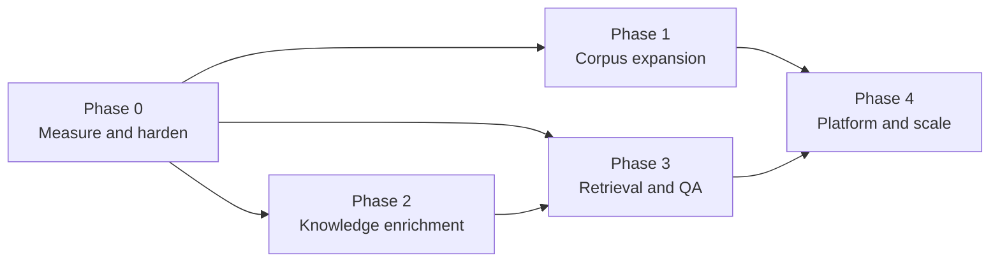

# 06 Roadmap: current limits and future expansion

This document records what the system does well today, where it is measurably weak, and a
phased plan for extending it. Each phase lists the extension points in the code, so the work
can be scoped from here.

## 1. Measured baseline

Offline retrieval evaluation, 28 questions (24 retrieval, 4 adversarial), `k = 8`:

| Configuration | hit@1 | hit@8 |
|---|---|---|
| BM25 + gazetteer expansion + entity boost (default) | 0.625 | 0.958 |
| BM25 only (`ikg eval --no-expand`) | 0.625 | 0.958 |

What this shows:

- **Retrieval nearly always finds the right part of the text** (23 of 24 within the top 8), but
  ranks it first only 62% of the time.
- **Graph expansion shows no measurable benefit on this set.** Most questions already use the
  same words as the translation ("Karna", "wheel", "chariot"). Only 5 questions target concepts,
  and none is phrased in Sanskrit where the translation uses an English rendering, which is the
  case the expansion is for. The set is too small and not targeted enough to support or reject
  design decision D3.
- **The single miss (`con-02`, "the dharma of a kshatriya on the battlefield according to
  Krishna")** retrieves Bhishma's teaching in the Shanti Parva instead of the Bhagavad Gita
  (Book 6). The system has no notion of *who is speaking*, so "according to Krishna" adds
  nothing to the query.
- **Answer-level metrics have never been recorded.** `ikg eval --llm` exists, but there is no
  baseline for citation precision or abstention.

Graph structure: 75 entities with 1,921 edges, a **density of 0.69**. Passages of up to 1,500
characters are large enough that most major figures co-occur somewhere, so an edge alone
carries little information. Only 356 edges have weight ≥ 50. The explorer works around this
by starting at a minimum of 10 shared passages (the API default is 5).

## 2. Known limitations

| # | Limitation | Effect | Where |
|---|---|---|---|
| L1 | Eval set is small (28) and has no rendering-targeted questions | Retrieval changes cannot be judged | `eval/questions.jsonl` |
| L2 | No speaker attribution | Questions like "according to Krishna" can't be answered precisely; answers can't say who said what | `segment.py`, `Passage` |
| L3 | Small gazetteer: 76 entities, a fraction of the named figures | Low extraction recall; most minor figures are invisible to the graph | `gazetteer.yaml` |
| L4 | No epithet or pronoun resolution beyond listed aliases | "the son of Pritha", "he" are not linked | `entities.py` |
| L5 | One entity per surface form; a duplicate alias silently overrides | A gazetteer edit could re-route an alias without warning | `Gazetteer.__init__` |
| L6 | Renderings like "duty" also match non-technical uses | Inflated concept counts; precision not measured | `gazetteer.yaml` |
| L7 | Co-occurrence only, no typed relations or claims | Graph answers "appear together", not "teaches", "son of", "fights" | `graph.py`, ontology `Claim` |
| L8 | Dense graph (0.69), raw counts as weights | Common figures dominate; weak edges are noise | `build_cooccurrence` |
| L9 | Sparse retrieval only | Paraphrased questions that share few words with the passage are missed | `retrieve.py` |
| L10 | State in process memory (sessions, rate limits, build job) | Single worker only; restart logs the admin out | `web/app.py` |
| L11 | One shared admin token, no roles or audit log | Not fit for a multi-curator team | `web/app.py` |
| L12 | YAML registry and file storage | Single host, single writer | `sources.py` |
| L13 | Placeholder RDF namespace `example.org` | RDF IRIs are not stable or resolvable | `graph.py`, `ontology/ikg.ttl` |
| L14 | `Advaita` (SchoolOfThought) has renderings, but `ikg:renders` has range `Concept` | Exported RDF is slightly inconsistent with the ontology | `gazetteer.yaml`, ontology |
| L15 | No tests for the RDF export, analysis report or CLI; no CI | Regressions there go unnoticed | `tests/`, `.github/` |
| L16 | Generic parser applies one `kind` to a whole upload | A book mixing translation and commentary can't be separated | `parse_generic` |
| L17 | Scanned PDFs (no text layer) are rejected | Some scholarship can't be contributed | `screen.py`, `read_source` |
| L18 | Gutenberg texts added by an admin are not screened | Depends on admin judgement | `/admin/gutenberg` |

## 3. Phased plan

The phases are ordered by dependency. Phase 0 makes later improvements measurable, so it
comes first.

### Phase 0: Measure and harden

**Goal:** every later change can be judged by numbers, and the basics are automated.

| Deliverable | Addresses | Extension point |
|---|---|---|
| Grow the eval set to about 150 questions: about 30 phrased in Sanskrit where the translation uses renderings, about 20 speaker-specific, about 20 cross-work, about 20 adversarial, and items for any added works | L1 | `eval/questions.jsonl` |
| Record the first `ikg eval --llm` baseline and commit the summary | §1 | `eval/results/` (commit summaries only) |
| GitHub Actions: `pytest` on push and PR (Windows + Linux) | L15 | `.github/workflows/` |
| Tests for `to_rdf`, `analysis.write_report`, CLI `search`/`stats` | L15 | `tests/` |
| Reject duplicate surface forms across entities in `Gazetteer.from_yaml`, unless they are scoped to different works | L5 | `entities.py` |
| Measure rendering precision on a sample of 100 mentions per ambiguous rendering, and drop or scope the noisy ones | L6 | `gazetteer.yaml`, `analysis.py` |
| Choose a permanent namespace (for example a `w3id.org` redirect) | L13 | `graph.IKG`, `graph.DATA`, ontology |
| Allow `Rendering` for SchoolOfThought (widen the range to `ikg:Entity`) or remove those renderings | L14 | ontology |
| Dockerfile (app + optional Ollama sidecar) | Deployment | repo root |

**Exit criteria:** CI is green, an eval baseline with LLM metrics is committed, and the
expansion ablation runs on the new set.

### Phase 1: Corpus expansion

**Goal:** more works and more editions of the same work, keeping the corpus public-domain.

| Deliverable | Notes | Extension point |
|---|---|---|
| More Puranas | Candidates already noted in `sources.yaml`: Bhagavata Purana (M. N. Dutt, 1895), Markandeya Purana (F. E. Pargiter, 1904), Garuda Purana (Wood & Subrahmanyam, 1911). Verify the source and licence of each | `sources.yaml` + a parser, or `generic` |
| More Upanishads and a standalone Bhagavad Gita | For example Max Müller's *Sacred Books of the East* Upanishads and Edwin Arnold's *The Song Celestial*. Check availability on Gutenberg or another public-domain source | same |
| **Parallel translations** of the same work | Enables comparing how translators render *dharma*, *atman* and other terms. This is the system's distinctive strength (D2). Needs an `edition` concept separate from `work` in passages | `Passage` (+ `edition`), `Work`, RDF `Edition` already modelled |
| Vedas (e.g. Griffith's Rig Veda hymns) | New structure: mandala / sukta / verse | new parser |
| Sanskrit originals with verse-level alignment to translations | Sources such as GRETIL have varied licences, so check each. Enables "show the Sanskrit" and checking renderings against the original | new `language` field, alignment table, Devanagari/IAST handling in `normalize.py` |
| Mixed-kind uploads | Mark commentary inside an upload, e.g. `> ` blocks or a `[commentary]` heading | `parse_generic` (L16) |
| OCR for scanned PDFs | Optional local OCR (Tesseract) before screening | `read_source`, `screen.extract_text` (L17) |

**How to add a work today:** add an entry to `src/ikg/data/sources.yaml`. If the layout is
irregular, add `parse_<name>` to `segment.PARSERS`, using a stable, hierarchical ID prefix. Add
a `WORK_LABELS` entry and fixture-based parser tests in `tests/test_segment.py`. Then run
`ikg fetch && ikg build && ikg eval`. For one-off texts, use the admin UI with the `generic`
parser.

### Phase 2: Knowledge enrichment

**Goal:** turn the co-occurrence graph into a graph of typed, evidenced relations.

| Deliverable | Approach | Extension point |
|---|---|---|
| **Speaker attribution** (Mahabharata first) | Deterministic. Ganguli marks speakers as `"X said,"`: 3,599 markers in 2,904 of 12,561 passages (23%). Carry the last speaker forward within a section to cover the rest, then add `speaker` and `addressee` to `Passage` | `segment.py`, `Passage`, retrieval filter `speaker=` |
| Speaker-aware retrieval | Detect "according to X" or "what does X say" and boost passages where X speaks. Target: fix `con-02` and the new speaker questions | `retrieve.search` |
| Gazetteer growth with review | Mine candidate names (frequent capitalised n-grams not in the gazetteer), have the local model suggest type and aliases, and queue them for admin approval like uploads | new `ikg suggest-entities`, admin queue |
| Epithets and patronymics | Add common epithets (Partha, Kaunteya, Dhananjaya, Vasudeva...) with per-work scoping | `gazetteer.yaml` |
| Better edge weights | Use sentence- or paragraph-window co-occurrence, and weight by PMI or another association score instead of raw counts. Target: graph density well below 0.69 | `build_cooccurrence` |
| Typed relations | Kinship (fixed, curated YAML), plus relations extracted from text (`teaches`, `fights`, `marries`) proposed by a model and accepted by a reviewer, each grounded in a passage ID | new `relations.yaml`, RDF properties, ontology |
| Populate `ikg:Claim` | Curated propositions with `statedBy`, `about`, `groundedIn`, and optionally `heldBy` (school). Shown on entity pages and used as QA context | ontology (exists), new `claims.yaml`, `to_rdf` |

**Principle carried forward:** model output never goes into the graph without a reviewer and
a supporting passage ID. This keeps the traceability guarantee (NFR-1) and reproducible builds
(NFR-2): accepted facts are stored as data and replayed during the build.

### Phase 3: Retrieval and QA

**Goal:** better ranking and richer questions, every change justified by the Phase 0 eval.

| Deliverable | Approach | Extension point |
|---|---|---|
| Hybrid retrieval | Add a dense index from a local embedding model (`nomic-embed-text` is already in Ollama on the dev machine), combined with BM25 by reciprocal rank fusion. Keep BM25-only as a fallback | `retrieve.py`, `build()` |
| Re-ranking | Re-rank the top 50 with a cross-encoder or a small local model, then pass the top `k` to Claude | `retrieve.search` / `qa.ask` |
| Compare-translations mode | "How do Ganguli and another translator render X?", using parallel editions (Phase 1) | `qa.py` (new prompt), UI |
| Speaker- and school-aware answers | Pass `speaker` and `heldBy` into the document `context`, and require the model to name speakers | `qa._documents`, prompt |
| Multi-turn conversation | Keep the conversation in the browser; retrieve per turn using the rewritten question | `/api/ask`, UI |
| Sanskrit input | Accept IAST or Devanagari queries, transliterate, then match aliases | `normalize.py` |
| Provider abstraction | Keep Claude as the default, behind a small interface so evaluation can compare providers | `qa.ask` |

**Acceptance:** each change must improve hit@1 or citation precision on the Phase 0 set without
raising `false_abstain_rate`, and the ablation results go in the PR.

### Phase 4: Platform and scale

**Goal:** a multi-curator public service.

| Deliverable | Addresses | Notes |
|---|---|---|
| SQLite (then Postgres) for the work registry, sessions, rate limits, build jobs and review queues | L10, L12 | Allows multiple workers; YAML stays as an import/export format |
| OIDC login with roles (reader, contributor, reviewer, admin) and an audit log | L11 | Replaces the shared token |
| Job queue for builds and screening (e.g. RQ or arq) | L10 | Builds no longer run in the web process |
| Incremental builds (per work) | Build time | Needed once the corpus is 10× larger; passage IDs are already stable per work |
| SPARQL endpoint (e.g. Oxigraph) and published RDF dumps | L13 | Linked-data access for researchers |
| Public read API with keys and quotas | NFR-5 | Builds on `/api/*` |
| UI translations (Hindi first) | Reach | Jinja2 i18n |
| Screen admin-added Gutenberg texts at rebuild time | L18 | Reuse `screen.screen` on the downloaded text |

## 4. Suggested order

| Priority | Item | Impact | Effort |
|---|---|---|---|
| 1 | Eval expansion + LLM baseline + CI (Phase 0) | High: everything else depends on it | S–M |
| 2 | Speaker attribution + speaker-aware retrieval (Phase 2) | High: fixes a known miss and enables "who said what" | M |
| 3 | Gazetteer growth with review + epithets (Phase 2) | High: extraction recall | M |
| 4 | Better edge weights (Phase 2) | Medium: makes the graph informative | S |
| 5 | Parallel translations (Phase 1) | High: the distinctive research feature | M–L |
| 6 | Hybrid retrieval + re-ranking (Phase 3) | Medium; must be shown by eval | M |
| 7 | Database, OIDC, job queue (Phase 4) | Needed before a public multi-curator launch | L |

S = days, M = 1–3 weeks, L = more than 3 weeks, for one developer.

## 5. Extension points reference

| To add… | Change |
|---|---|
| A work | `sources.yaml` entry; parser in `segment.PARSERS` if needed; `WORK_LABELS`; parser test; eval questions |
| An entity | `gazetteer.yaml` (or the admin editor), then rebuild |
| An entity type | Gazetteer `type`, ontology class, `--c-<type>` colour in all three theme blocks of `style.css`, `typeColor` in `graph.js`, a `.chip.<type>` style (the graph page's type filters are generated from the gazetteer) |
| A passage kind | `segment.KINDS` (and `PRIMARY_KINDS` if it is primary text), ontology subclass, prompt wording in `qa.SYSTEM_PROMPT`, contribute form options |
| A passage attribute (e.g. `speaker`) | `Passage` dataclass, which flows through JSONL and the pickle automatically; parser; RDF in `to_rdf`; retrieval filter; `qa._documents` context |
| A retrieval signal | `retrieve.search`; add an `expand`-style switch so `ikg eval` can ablate it |
| An RDF property | `ontology/ikg.ttl`, then `graph.to_rdf`, then a test |
| A screening rule | `screen.SYSTEM_PROMPT`; or a different model via `IKG_SCREEN_MODEL` |
| An analysis | A function in `analysis.py` returning Markdown, called from `write_report` |
| A route | `web/app.py` inside `create_app()`, a template in `web/templates/`, and a test in `tests/test_web.py` |
