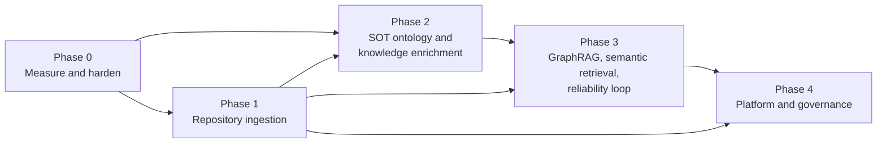

# 06 Roadmap: current limits and future expansion

This document records what the system does well today, where it is measurably weak, and a
phased plan for extending it. Each phase lists the extension points in the code, so the work
can be scoped from here.

## 1. Measured baseline

Offline retrieval evaluation, 28 questions (24 retrieval, 4 adversarial), `k = 8`:

| Configuration | hit@1 | hit@8 |
|---|---|---|
| BM25 + gazetteer expansion + entity boost (default) | 0.625 | 0.958 |
| BM25 only (`ikg eval --no-expand`) | 0.625 | 0.958 |

What this shows:

- **Retrieval nearly always finds the right part of the text** (23 of 24 within the top 8), but
  ranks it first only 62% of the time.
- **Graph expansion shows no measurable benefit on this set.** Most questions already use the
  same words as the translation ("Karna", "wheel", "chariot"). Only 5 questions target concepts,
  and none is phrased in Sanskrit where the translation uses an English rendering, which is the
  case the expansion is for. The set is too small and not targeted enough to support or reject
  design decision D3.
- **The single miss (`con-02`, "the dharma of a kshatriya on the battlefield according to
  Krishna")** retrieves Bhishma's teaching in the Shanti Parva instead of the Bhagavad Gita
  (Book 6). The system has no notion of *who is speaking*, so "according to Krishna" adds
  nothing to the query.
- **Answer-level metrics have never been recorded.** `ikg eval --llm` exists, but there is no
  baseline for citation precision or abstention.

Graph structure: 75 entities with 1,921 edges, a **density of 0.69**. Passages of up to 1,500
characters are large enough that most major figures co-occur somewhere, so an edge alone
carries little information. Only 356 edges have weight ≥ 50. The explorer works around this
by starting at a minimum of 10 shared passages (the API default is 5).

## 2. Known limitations

| # | Limitation | Effect | Where |
|---|---|---|---|
| L1 | Eval set is small (28) and has no rendering-targeted questions | Retrieval changes cannot be judged | `eval/questions.jsonl` |
| L2 | No speaker attribution | Questions like "according to Krishna" can't be answered precisely; answers can't say who said what | `segment.py`, `Passage` |
| L3 | Small gazetteer: 76 entities, a fraction of the named figures | Low extraction recall; most minor figures are invisible to the graph | `gazetteer.yaml` |
| L4 | No epithet or pronoun resolution beyond listed aliases | "the son of Pritha", "he" are not linked | `entities.py` |
| L5 | One entity per surface form; a duplicate alias silently overrides | A gazetteer edit could re-route an alias without warning | `Gazetteer.__init__` |
| L6 | Renderings like "duty" also match non-technical uses | Inflated concept counts; precision not measured | `gazetteer.yaml` |
| L7 | Co-occurrence only, no typed relations or claims | Graph answers "appear together", not "teaches", "son of", "fights" | `graph.py`, ontology `Claim` |
| L8 | Dense graph (0.69), raw counts as weights | Common figures dominate; weak edges are noise | `build_cooccurrence` |
| L9 | Sparse retrieval only | Paraphrased questions that share few words with the passage are missed | `retrieve.py` |
| L10 | State in process memory (sessions, rate limits, build job) | Single worker only; restart logs the admin out | `web/app.py` |
| L11 | One shared admin token, no roles or audit log | Not fit for a multi-curator team | `web/app.py` |
| L12 | YAML registry and file storage | Single host, single writer | `sources.py` |
| L13 | Placeholder RDF namespace `example.org` | RDF IRIs are not stable or resolvable | `graph.py`, `ontology/ikg.ttl` |
| L14 | `Advaita` (SchoolOfThought) has renderings, but `ikg:renders` has range `Concept` | Exported RDF is slightly inconsistent with the ontology | `gazetteer.yaml`, ontology |
| L15 | No tests for the RDF export, analysis report or CLI; no CI | Regressions there go unnoticed | `tests/`, `.github/` |
| L16 | Generic parser applies one `kind` to a whole upload | A book mixing translation and commentary can't be separated | `parse_generic` |
| L17 | Scanned PDFs (no text layer) are rejected | Some scholarship can't be contributed | `screen.py`, `read_source` |
| L18 | Gutenberg texts added by an admin are not screened | Depends on admin judgement | `/admin/gutenberg` |

## 3. Phased plan toward the target

The phases are ordered by dependency and aimed at the target system
([01 §0](01-specification.md#0-target-system-and-this-prototype)). [07](07-target-alignment.md)
maps each target capability (T1–T15) to the phase that delivers it. Phase 0 makes every later
change measurable, so it comes first.

### Phase 0: Measure and harden (T10)

**Goal:** every later change can be judged by numbers, including the target's metrics.

| Deliverable | Addresses | Extension point |
|---|---|---|
| Grow the eval set to about 150 items: about 30 phrased in Sanskrit where the translation uses renderings, about 20 speaker-specific, about 20 cross-work, about 20 adversarial (false premises, misattributions, out-of-corpus) | L1, T10 | `eval/questions.jsonl` |
| **Multi-turn eval items**: conversations whose follow-ups depend on earlier turns ("and how does Shankara read that verse?") | T10 | new `type: multiturn` in `evaluate.py` |
| **SOT-fidelity eval items** and the four rates from [07 §2](07-target-alignment.md#2-sot-fidelity-definition-and-measurement) (attribution, separation, own terms, debate position), using a rubric-guided LLM judge checked against SME labels | T7, T10 | `evaluate.py` |
| Record the first `ikg eval --llm` baseline and commit the summary | §1 | `eval/results/` (commit summaries only) |
| GitHub Actions: `pytest` plus an offline eval regression gate on every PR | L15, T10 | `.github/workflows/` |
| Tests for `to_rdf`, `analysis.write_report`, CLI `search`/`stats` | L15 | `tests/` |
| Reject duplicate surface forms across entities in the gazetteer validator | L5 | `entities.py` |
| Measure rendering precision on a sample of 100 mentions per ambiguous rendering; scope or drop noisy ones | L6 | `gazetteer.yaml`, `analysis.py` |
| Choose a permanent namespace; widen the `renders` range | L13, L14 | `graph.py`, ontology |
| Dockerfile (app + optional Ollama sidecar) | Deployment | repo root |

**Exit criteria:** CI is green; baselines for retrieval, citations, abstention and SOT fidelity
are committed.

### Phase 1: Repository ingestion (T3, T5, T15)

**Goal:** ingest a scholarly repository like the target's (books, papers, lectures, videos)
with precise citations, classification, and links to the primary texts.

| Deliverable | Approach | Extension point |
|---|---|---|
| Book ingestion with **page-level citations** | PDF (keeping page numbers), EPUB and DOCX. Chapter/section detection. A `page` field on passages, cited as *title, ch. 3, p. 112* | `read_source`, new parsers, `Passage` (+ `page`) |
| **Lecture and video ingestion** | Local Whisper transcription with timestamps; passages are transcript windows cited as *title @ 12:34*, with a link to the moment | new `transcribe.py`, `Passage` (+ `start_time`, `end_time`) |
| Research papers | PDF with section structure, abstract and references | `parse_generic`, metadata |
| **Metadata catalogue** | Author, year, type, ISBN/DOI, rights, collection. Stored as a registry, later in the database | `Work` dataclass, `works.yaml` |
| **Classification** | A local model labels each source and section with topics, schools of thought and primary works discussed. Labels are reviewed by SMEs and stored as data | `screen.py` pattern, new review queue |
| **Linking scholarship to primary texts** | Detect verse references (*Katha 1.2.18*, *BG 2.47*, *MBh 12.59*) and quoted passages. Resolve them to passage IDs as `citesPassage` edges | new `links.py`, RDF |
| Access control for copyrighted material | Repository text shown only to authorised users, in cited excerpts | `web/app.py`; Phase 4 auth |
| Public-domain expansion (secondary) | More Puranas, Upanishads and Gita editions. **Parallel translations**, including editions that follow Indic traditions of interpretation alongside the 19th-century European translations, to compare renderings | `sources.yaml`, parsers, `Passage` (+ `edition`) |
| Mixed-kind uploads and OCR | Mark commentary inside uploads; optional local OCR for scanned PDFs | `parse_generic`, `read_source` (L16, L17) |

### Phase 2: SOT ontology and knowledge enrichment (T1, T2, T7, T11)

**Goal:** a graph of schools of thought, thinkers, frameworks and claims with typed,
evidence-backed relations, built together with SMEs.

| Deliverable | Approach | Extension point |
|---|---|---|
| **Ontology extensions** | Thinker, Framework, populated Claims, `critiques`/`respondsTo`/`interprets`, debate roles, `citesPassage`, page/time segments, provenance ([07 §3](07-target-alignment.md#3-ontology-extensions-the-target-needs)) | `ontology/ikg.ttl`, `to_rdf` |
| **SME curation workflow** | Review queues for proposed entities, relations, claims and classifications, with approve/edit/reject and provenance (who proposed, who approved). Ontology change proposals | `web/app.py`, new `curation.py`, data files replayed in the build |
| Claim extraction | A model proposes claims ("X holds that Y", grounded in passage P, attributed to thinker or SOT S); SMEs approve | new `claims.py`, `claims.yaml` |
| **Speaker attribution** (Mahabharata first) | Deterministic. Ganguli marks speakers as `"X said,"`: 3,599 markers in 2,904 of 12,561 passages (23%). Carry the last speaker forward within a section | `segment.py`, `Passage` (+ `speaker`, `addressee`) |
| **Debate-role tagging** | Mark *pūrvapakṣa* vs. *siddhānta* in commentarial and scholarly texts (model proposes, SME approves) | `Passage` or `Claim` attribute |
| Gazetteer growth with review | Mine candidate names; a local model suggests type and aliases; queue for approval. Add epithets and patronymics (Partha, Kaunteya, Vasudeva...) | `ikg suggest-entities`, admin queue |
| Better edge weights | Sentence-window co-occurrence with PMI weighting. Target: density well below 0.69 | `build_cooccurrence` |
| Kinship and other fixed relations | Curated YAML with passage evidence | `relations.yaml`, RDF |

**Principle:** model output never goes into the graph without SME approval and a supporting
passage ID. Approved facts are stored as data and replayed during the build. This keeps
traceability (NFR-1) and reproducibility (NFR-2).

### Phase 3: GraphRAG, semantic retrieval and the reliability loop (T4, T6, T8, T9, T14)

**Goal:** better retrieval, multi-turn SOT-aware answers, and fewer hallucinations, with gaps
recorded for researchers.

| Deliverable | Approach | Extension point |
|---|---|---|
| **Hybrid retrieval** | Dense embeddings in a vector store (pgvector or Qdrant; the local `nomic-embed-text` model to start), combined with BM25 by reciprocal rank fusion | `retrieve.py`, `build()` |
| **Graph retrieval (GraphRAG)** | Expand from the question's entities and SOTs to their claims and evidence passages, plus communities of related concepts; add those passages to the candidate set | `retrieve.py`, `graph.py` |
| Re-ranking | Cross-encoder or a small local model over the top 50 | `retrieve.search` |
| **Speaker- and SOT-aware answering** | Pass speaker, SOT, thinker and debate role in each document's context; the prompt requires per-SOT attribution and separation | `qa._documents`, `SYSTEM_PROMPT` |
| **Multi-turn** | Conversation state; rewrite each follow-up as a standalone question; retrieve per turn; citations persist across turns | `/api/ask`, `qa.py`, UI |
| **Sentence-level citation verification** | A local model checks that each answer sentence is supported by its cited passage. Unsupported sentences are flagged or removed; the rate is a metric | new `verify.py`, `qa.ask` |
| **Knowledge-gap reporting** | Log abstentions, unsupported sentences and low-confidence retrievals. Aggregate them by concept, SOT and work into a gap report for researchers | new `gaps.py`, admin page |
| Sanskrit input | IAST or Devanagari queries, transliterated before alias matching | `normalize.py` |
| Provider abstraction | Claude by default; local or other models selectable to suit data governance and for comparison in evaluation | `qa.ask` |

**Acceptance:** each change must improve retrieval, citation accuracy or SOT fidelity on the
Phase 0 set without raising `false_abstain_rate`, and the ablation results go in the PR.

### Phase 4: Platform and governance (T12, T13)

**Goal:** a secure, multi-user service for a private repository and a team of curators.

| Deliverable | Addresses | Notes |
|---|---|---|
| Postgres for registries, sessions, rate limits, jobs, review queues, conversation logs; pgvector for embeddings | L10, L12 | YAML stays as an import/export format |
| OIDC login with roles (reader, researcher/SME, curator, admin) and an audit log | L11 | Needed before any copyrighted material is served |
| Graph store decision: RDF triple store (e.g. Oxigraph or GraphDB) vs. Neo4j, or both (RDF as the exchange format, Neo4j for traversal) | T13 | Decide with the Phase 2 query workload in hand |
| Job queue for builds, transcription, classification and screening | L10 | Builds leave the web process |
| Incremental builds per source | Scale | Passage IDs are already stable per work |
| LLM data-governance settings: hosted model retention configuration or local models per workload | Constraint | See [07 §4](07-target-alignment.md#4-constraints-the-target-adds) |
| Screen admin-added Gutenberg texts at rebuild time | L18 | Reuse `screen.screen` |
| UI translations (Hindi first) | Reach | Jinja2 i18n |

## 4. Suggested order

| Priority | Item | Target capability | Impact | Effort |
|---|---|---|---|---|
| 1 | Eval expansion incl. multi-turn and SOT fidelity, LLM baseline, CI gate (Phase 0) | T10 | High: everything else depends on it | M |
| 2 | Book + paper ingestion with page citations, metadata catalogue (Phase 1) | T3, T5 | High: the target's core content | M |
| 3 | Sentence-level citation verification + gap reporting (Phase 3) | T8, T9 | High: reliability, which the target stresses most | M |
| 4 | SOT/Thinker/Claim ontology + SME curation workflow (Phase 2) | T1, T2, T11 | High: the heart of the target | L |
| 5 | Hybrid + graph retrieval, multi-turn (Phase 3) | T4, T14 | High; must be shown by eval | M–L |
| 6 | Video/lecture transcription with timestamps (Phase 1) | T3 | Medium–high | M |
| 7 | Speaker attribution, debate roles, better edge weights (Phase 2) | T2, T7 | Medium | S–M |
| 8 | Postgres, OIDC + roles, job queue, graph store (Phase 4) | T12, T13 | Required before serving copyrighted material to users | L |

S = days, M = 1–3 weeks, L = more than 3 weeks, for one developer. Items 1 and 3 can run in
parallel. Item 3 needs only the existing corpus.

## 5. Extension points reference

| To add… | Change |
|---|---|
| A work | `sources.yaml` entry; parser in `segment.PARSERS` if needed; `WORK_LABELS`; parser test; eval questions |
| An entity | `gazetteer.yaml` (or the admin editor), then rebuild |
| An entity type | Gazetteer `type`, ontology class, `--c-<type>` colour in all three theme blocks of `style.css`, `typeColor` in `graph.js`, a `.chip.<type>` style (the graph page's type filters are generated from the gazetteer) |
| A passage kind | `segment.KINDS` (and `PRIMARY_KINDS` if it is primary text), ontology subclass, prompt wording in `qa.SYSTEM_PROMPT`, contribute form options |
| A passage attribute (e.g. `speaker`) | `Passage` dataclass, which flows through JSONL and the pickle automatically; parser; RDF in `to_rdf`; retrieval filter; `qa._documents` context |
| A retrieval signal | `retrieve.search`; add an `expand`-style switch so `ikg eval` can ablate it |
| An RDF property | `ontology/ikg.ttl`, then `graph.to_rdf`, then a test |
| A screening rule | `screen.SYSTEM_PROMPT`; or a different model via `IKG_SCREEN_MODEL` |
| An analysis | A function in `analysis.py` returning Markdown, called from `write_report` |
| A route | `web/app.py` inside `create_app()`, a template in `web/templates/`, and a test in `tests/test_web.py` |
